# OCSP Subsystem — Architecture & Blueprint

> **Version**: 1.0 · **Stack**: Java 21 · Spring Boot 3.3 · RabbitMQ 3.13 · MariaDB 10.11 · React 18

---

## Table of Contents

1. [System Blueprint](#1-system-blueprint)
2. [Sequence: OCSP Request Processing](#2-sequence-ocsp-request-processing)
3. [Sequence: Certificate Revocation Propagation](#3-sequence-certificate-revocation-propagation)
4. [Sequence: Cache Invalidation](#4-sequence-cache-invalidation)
5. [Sequence: Hourly Reconciliation](#5-sequence-hourly-reconciliation)
6. [Sequence: OCSP Signing Cert Rotation](#6-sequence-ocsp-signing-cert-rotation)
7. [Sequence: Admin Console — Manual Cache Invalidation](#7-sequence-admin-console--manual-cache-invalidation)
8. [Data Model ERD](#8-data-model-erd)
9. [RabbitMQ Topology](#9-rabbitmq-topology)
10. [Deployment Blueprint](#10-deployment-blueprint)
11. [Security Boundary Diagram](#11-security-boundary-diagram)

---

## 1. System Blueprint

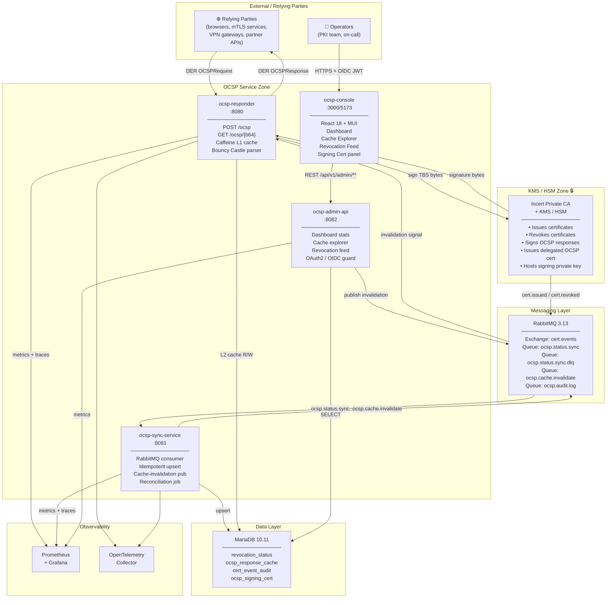

---

## 2. Sequence: OCSP Request Processing

This is the **hot path** — the critical path of every TLS/mTLS handshake that triggers an OCSP check.

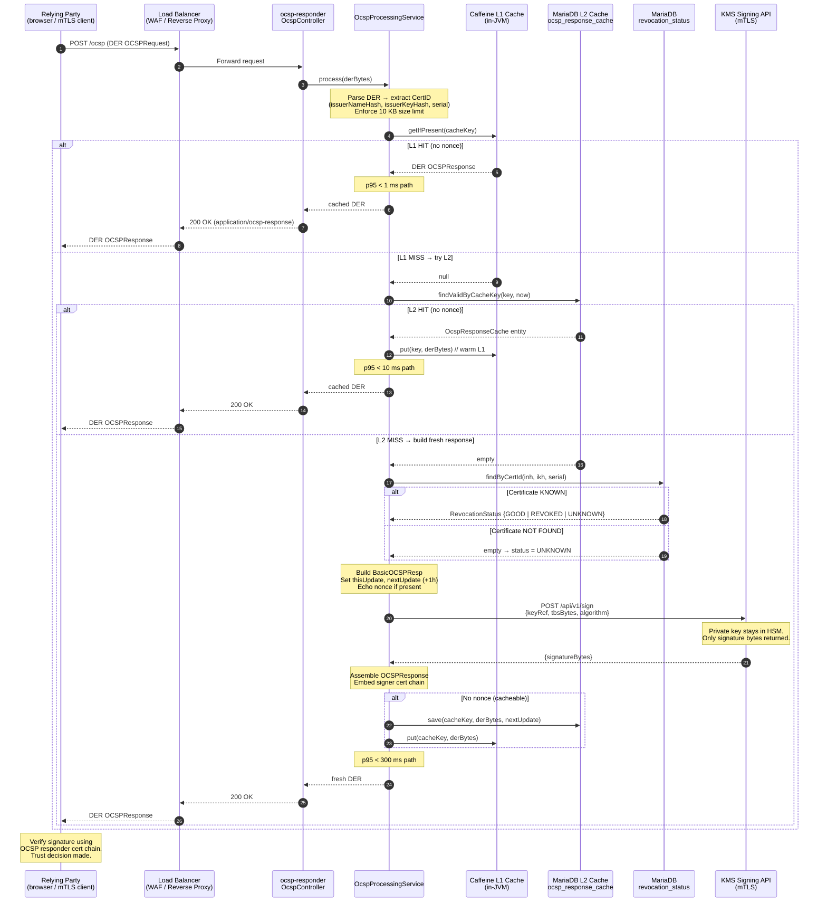

---

## 3. Sequence: Certificate Revocation Propagation

From the operator revoking a cert in the KMS to every OCSP responder reflecting `revoked` — target **< 60 seconds**.

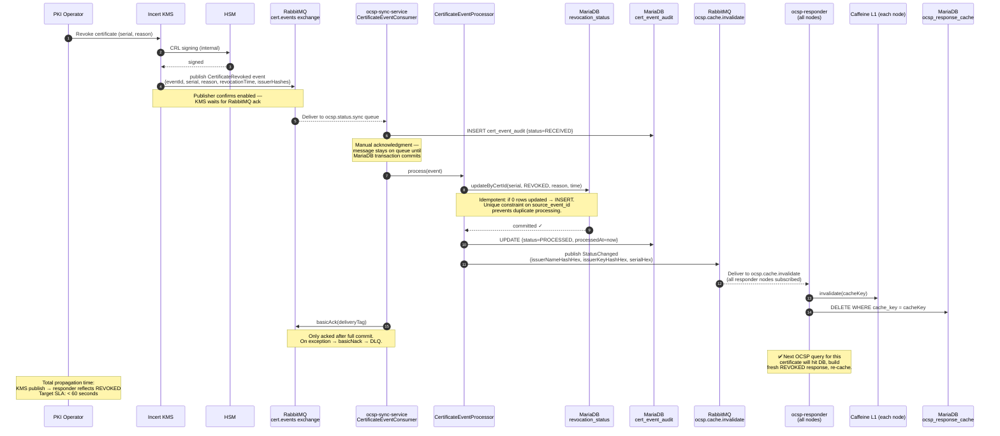

---

## 4. Sequence: Cache Invalidation

Detail of the cache eviction flow across a fleet of responder nodes.

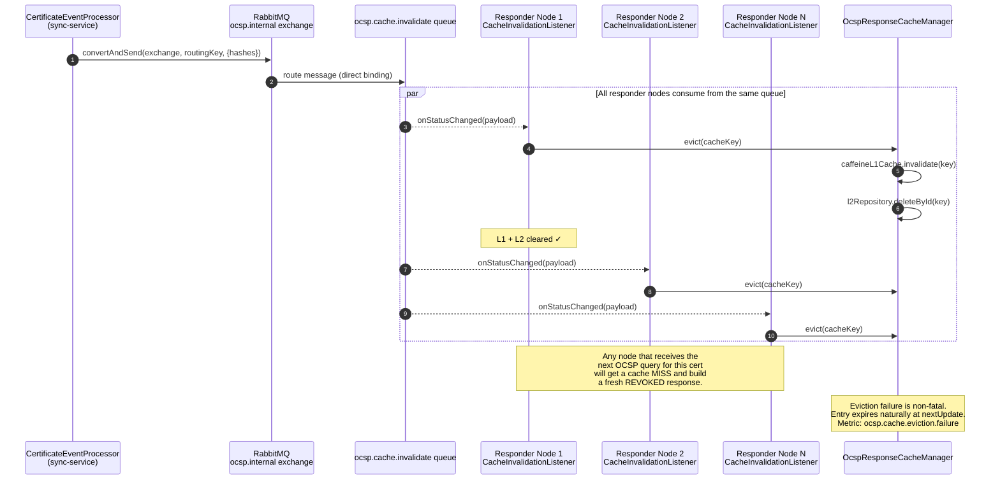

---

## 5. Sequence: Hourly Reconciliation

Belt-and-braces defense against missed RabbitMQ events (message loss, partition, KMS bug).

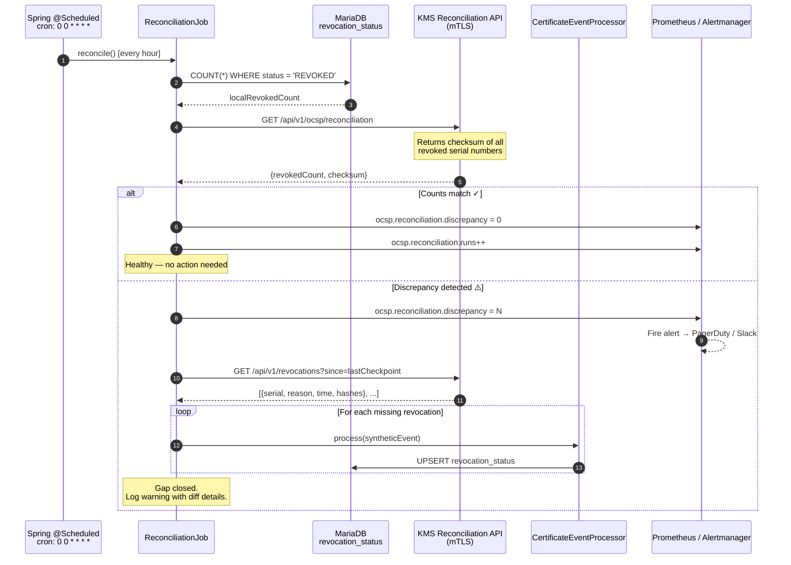

---

## 6. Sequence: OCSP Signing Cert Rotation

The delegated signing certificate has a short lifetime (90 days). Rotation is automated via the KMS.

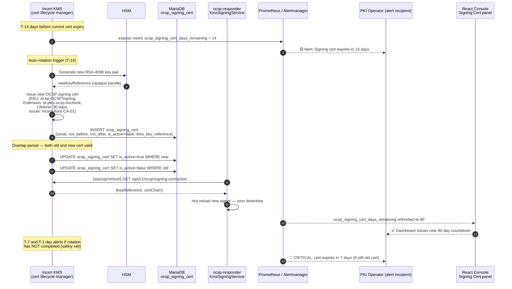

---

## 7. Sequence: Admin Console — Manual Cache Invalidation

An operator force-refreshes a specific certificate's cached OCSP response from the React console.

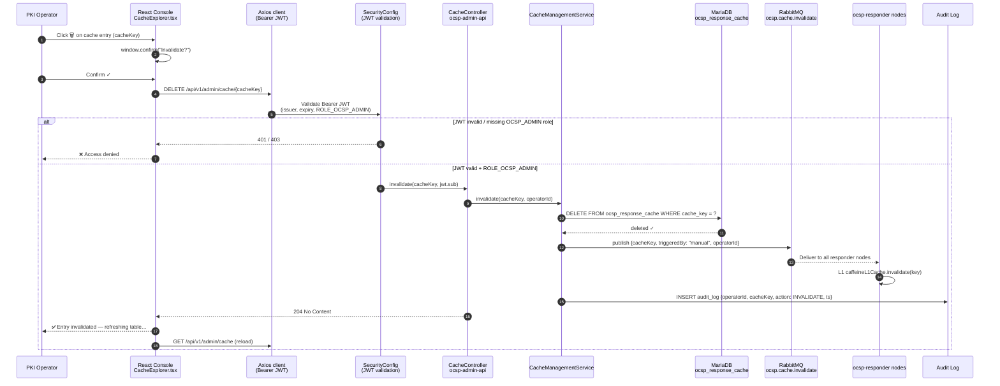

---

## 8. Data Model ERD

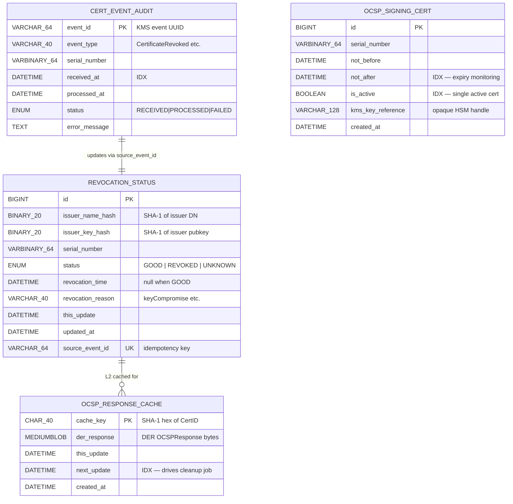

---

## 9. RabbitMQ Topology

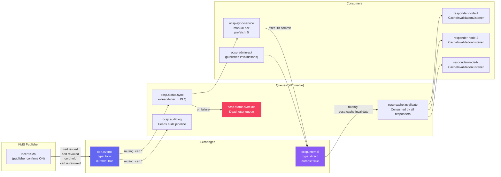

---

## 10. Deployment Blueprint

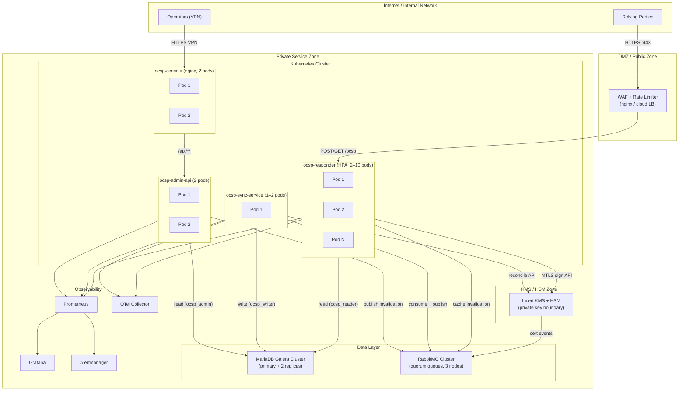

---

## 11. Security Boundary Diagram

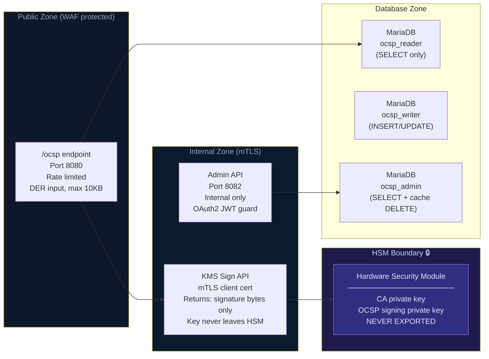

> [!CAUTION]
> The HSM boundary is the most critical security control. `KmsBackedContentSigner` sends only TBS (to-be-signed) bytes to the KMS and receives only signature bytes back — the private key material is **never** transferred across any network boundary.

---

## Component Responsibilities Summary

| Component | Reads from | Writes to | Security boundary |
|---|---|---|---|
| `ocsp-responder` | `revocation_status` (RO), `ocsp_response_cache` (R/W), Caffeine L1 | `ocsp_response_cache` (L2 cache) | Public `/ocsp` behind WAF |
| `ocsp-sync-service` | RabbitMQ `ocsp.status.sync` | `revocation_status`, `cert_event_audit`, `ocsp.cache.invalidate` | Internal, no public exposure |
| `ocsp-admin-api` | `revocation_status`, `cert_event_audit`, `ocsp_signing_cert`, `ocsp_response_cache` | `ocsp.cache.invalidate` (via RMQ) | Internal, OAuth2/OIDC only |
| `ocsp-console` | Admin API REST | — | Internal, operators via VPN + SSO |
| `KMS / HSM` | — | `cert.events` (RMQ), signature bytes | Isolated HSM zone, mTLS ingress only |
