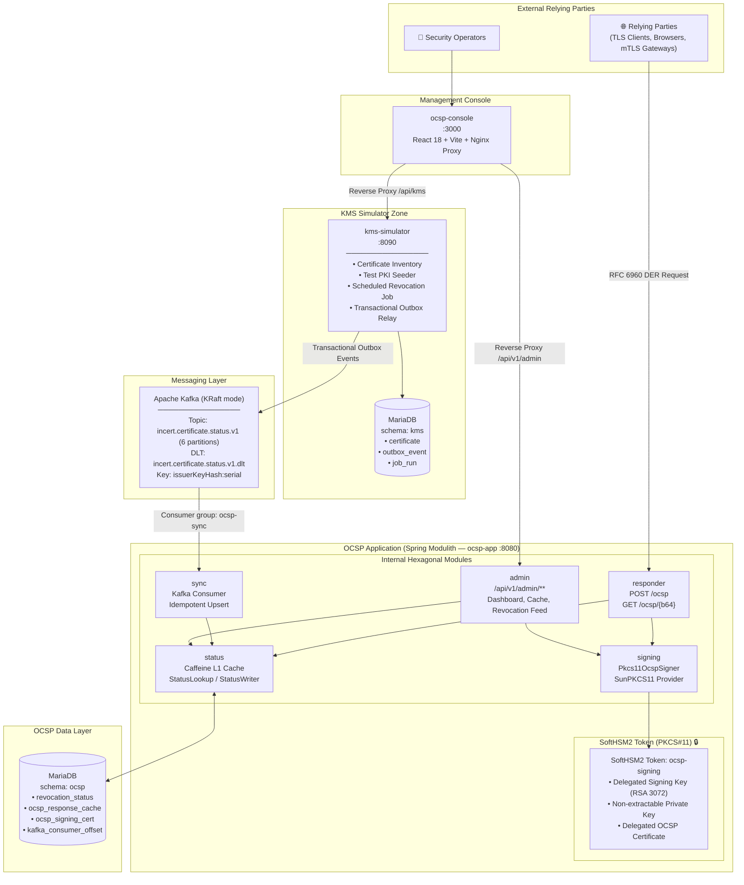
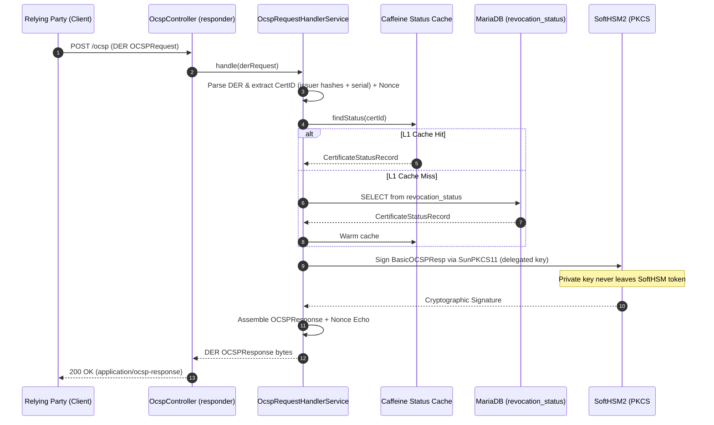
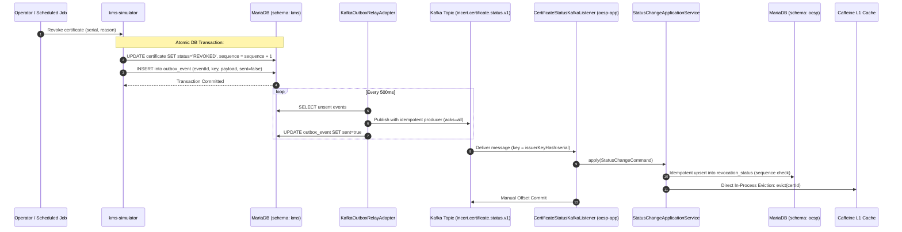
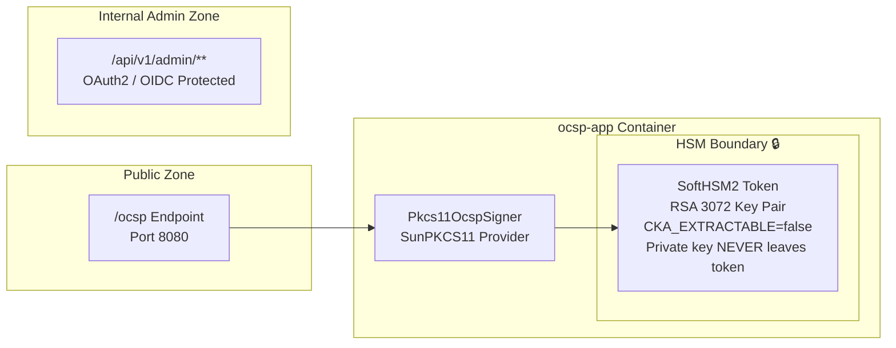

# Incert OCSP Subsystem — Architecture & Blueprint (v2.0)

> **Version**: 2.0 · **Stack**: Java 21 · Spring Boot 3.3 · Spring Modulith 1.2 · Apache Kafka 3.8 (KRaft) · SoftHSM2 (PKCS#11) · MariaDB 10.11 · React 18

---

## Table of Contents
1. [Target System Blueprint](#1-target-system-blueprint)
2. [Sequence: OCSP Request Processing & PKCS#11 Signing](#2-sequence-ocsp-request-processing--pkcs11-signing)
3. [Sequence: Certificate Revocation via Transactional Outbox & Kafka](#3-sequence-certificate-revocation-via-transactional-outbox--kafka)
4. [Sequence: In-Process Cache Invalidation](#4-sequence-in-process-cache-invalidation)
5. [Database Data Models (ERDs)](#5-database-data-models-erds)
6. [Kafka Topology](#6-kafka-topology)
7. [Deployment Blueprint](#7-deployment-blueprint)
8. [Security Boundary Diagram](#8-security-boundary-diagram)

---

## 1. Target System Blueprint



---

## 2. Sequence: OCSP Request Processing & PKCS#11 Signing



---

## 3. Sequence: Certificate Revocation via Transactional Outbox & Kafka



---

## 4. Sequence: In-Process Cache Invalidation

Because the OCSP responder and sync worker are merged into a single modular monolith (`ocsp-app`), cache invalidation no longer requires a message broker roundtrip. When a status update is committed by `sync`, the L1 Caffeine cache in `status` is evicted directly in-memory via the `CacheEvictor` port interface.

---

## 5. Database Data Models (ERDs)

### KMS Schema (`kms`)
```
+-----------------------------------------------------------+
|                        certificate                        |
+-----------------------------------------------------------+
| id                  BIGINT UNSIGNED PK AUTO_INCREMENT    |
| serial_number_hex   VARCHAR(128) UNIQUE                  |
| issuer_dn           VARCHAR(512)                          |
| issuer_key_hash_hex VARCHAR(40)                           |
| issuer_name_hash_hex VARCHAR(40)                          |
| subject_dn          VARCHAR(512)                          |
| not_before          DATETIME(3)                           |
| not_after           DATETIME(3)                           |
| status              ENUM('GOOD','REVOKED')                |
| revocation_time     DATETIME(3) NULL                      |
| revocation_reason   VARCHAR(30) NULL                      |
| pem_encoded         MEDIUMTEXT                            |
| sequence            BIGINT NOT NULL DEFAULT 0             |
| updated_at          DATETIME(3)                           |
+-----------------------------------------------------------+

+-----------------------------------------------------------+
|                       outbox_event                        |
+-----------------------------------------------------------+
| event_id            VARCHAR(64) PK                        |
| topic               VARCHAR(128)                          |
| kafka_key           VARCHAR(256)                          |
| payload             TEXT                                  |
| created_at          DATETIME(3)                           |
| sent_at             DATETIME(3) NULL                      |
| sent                BOOLEAN NOT NULL DEFAULT FALSE        |
+-----------------------------------------------------------+
```

### OCSP Schema (`ocsp`)
```
+-----------------------------------------------------------+
|                     revocation_status                     |
+-----------------------------------------------------------+
| id                  BIGINT UNSIGNED PK AUTO_INCREMENT    |
| issuer_name_hash    BINARY(20) NOT NULL                   |
| issuer_key_hash     BINARY(20) NOT NULL                   |
| serial_number       VARBINARY(64) NOT NULL                |
| status              ENUM('GOOD','REVOKED','UNKNOWN')      |
| revocation_time     DATETIME(3) NULL                      |
| revocation_reason   VARCHAR(30) NULL                      |
| this_update         DATETIME(3)                           |
| updated_at          DATETIME(3)                           |
| source_event_id     VARCHAR(64) UNIQUE                    |
| sequence            BIGINT NOT NULL DEFAULT 0             |
| UQ (issuer_name_hash, issuer_key_hash, serial_number)     |
+-----------------------------------------------------------+

+-----------------------------------------------------------+
|                    ocsp_signing_cert                      |
+-----------------------------------------------------------+
| id                  BIGINT UNSIGNED PK AUTO_INCREMENT    |
| serial_number       VARBINARY(64)                         |
| not_before          DATETIME(3)                           |
| not_after           DATETIME(3)                           |
| is_active           BOOLEAN NOT NULL DEFAULT TRUE         |
| hsm_key_label       VARCHAR(128)                          |
| created_at          DATETIME(3)                           |
+-----------------------------------------------------------+

+-----------------------------------------------------------+
|                   ocsp_response_cache (L2)                |
+-----------------------------------------------------------+
| cache_key           VARCHAR(128) PK (hex issuerKeyHash:sn)|
| der_response        LONGBLOB NOT NULL (pre-signed response|
| this_update         DATETIME(3)                           |
| next_update         DATETIME(3)                           |
| created_at          DATETIME(3)                           |
| INDEX idx_next_update (next_update)                       |
+-----------------------------------------------------------+
```

---

## 6. Kafka Topology

- **Topic**: `incert.certificate.status.v1`
  - Partitions: 6
  - Key: `issuerKeyHash:serialNumber` (guarantees strict per-certificate ordering)
  - Retention: 7 days
- **Dead Letter Topic**: `incert.certificate.status.v1.dlt`
  - Partitions: 1
  - Purpose: Poison message quarantine with header metadata

---

## 7. Deployment Blueprint

The target deployment operates 5 Docker containers:
1. `ocsp-mariadb`: Hosts databases `ocsp` and `kms` on port 3307/3306.
2. `ocsp-kafka`: Apache Kafka in KRaft mode (no ZooKeeper) on port 9092.
3. `ocsp-kms`: KMS simulator running seed PKI, REST management, and outbox relay on port 8090.
4. `ocsp-app`: Modulith containing responder, status cache, PKCS#11 signer, and sync consumer on port 8080.
5. `ocsp-console`: React 18 admin interface served via Nginx reverse proxy on port 3000.

---

## 8. Security Boundary Diagram


