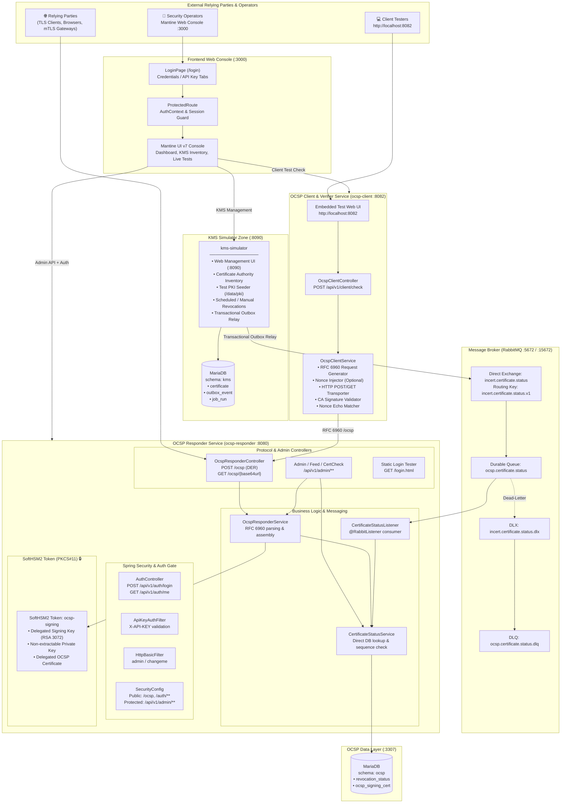
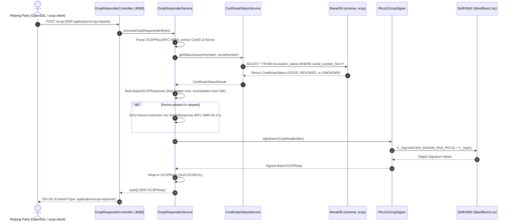
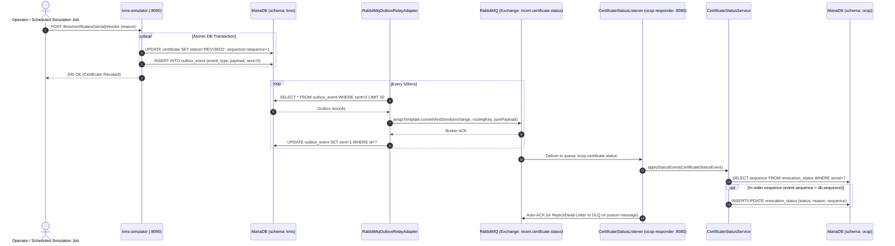
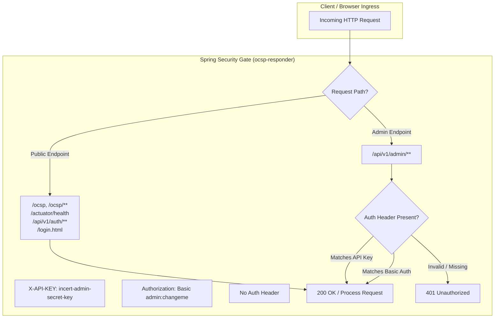
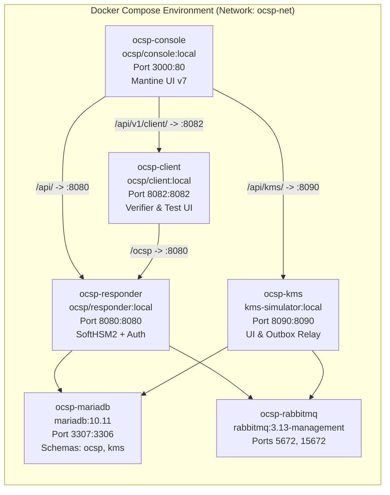
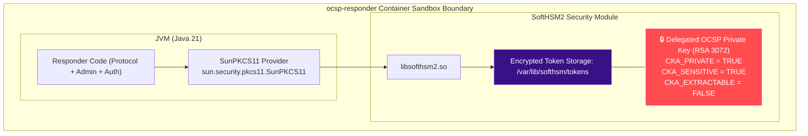

# Incert OCSP Subsystem — Architecture & Blueprint (v4.0)

> **Version**: 4.0 · **Architecture**: Standalone Distributed Services & Pure Event Bus · **Stack**: Java 21 · Spring Boot 3.3 · RabbitMQ 3.13 · SoftHSM2 (PKCS#11) · MariaDB 10.11 · Mantine UI v7 (React 18)

---

## Table of Contents
1. [Target System Blueprint](#1-target-system-blueprint)
2. [Sequence: OCSP Request Processing & PKCS#11 Dynamic Signing](#2-sequence-ocsp-request-processing--pkcs11-dynamic-signing)
3. [Sequence: Certificate Revocation via Transactional Outbox & RabbitMQ](#3-sequence-certificate-revocation-via-transactional-outbox--rabbitmq)
4. [Standalone OCSP Client & Relying Party Verification Flow](#4-standalone-ocsp-client--relying-party-verification-flow)
5. [Authentication, Authorization & Console Security](#5-authentication-authorization--console-security)
6. [Database Data Models (ERDs)](#6-database-data-models-erds)
7. [RabbitMQ Messaging Topology](#7-rabbitmq-messaging-topology)
8. [Deployment Blueprint (Docker Compose Topology)](#8-deployment-blueprint-docker-compose-topology)
9. [Security & Cryptographic Boundary Diagram](#9-security--cryptographic-boundary-diagram)

---

## 1. Target System Blueprint

---

## 2. Sequence: OCSP Request Processing & PKCS#11 Dynamic Signing

Every OCSP request (whether containing a nonce or nonce-free) queries the MariaDB `revocation_status` table directly and is dynamically signed by SoftHSM2 via PKCS#11. Responses are generated on-the-fly without stale cache windows, guaranteeing instantaneous consistency with revocations emitted via RabbitMQ.

---

## 3. Sequence: Certificate Revocation via Transactional Outbox & RabbitMQ

Zero HTTP reconciliation or polling is performed. All revocation mutations in KMS are atomically persisted alongside an outbox event, asynchronously relayed to RabbitMQ, and ingested in real time by the Responder.

---

## 4. Standalone OCSP Client & Relying Party Verification Flow

The `ocsp-client` application is an independent service running on port `8082` that acts as a real-world relying party:

1. **RFC 6960 Request Construction**:
   - Computes SHA-1 hash over Issuer Name and Public Key to generate the `CertID`.
   - Injects a cryptographically secure 16-byte random Nonce when configured.
2. **Transport Layer Flexibility**:
   - Supports both HTTP `POST` (binary DER body with `Content-Type: application/ocsp-request`) and HTTP `GET` (RFC 6960 Appendix A `/{base64url}` format).
3. **Response Validation**:
   - Verifies response status code `SUCCESSFUL`.
   - Cryptographically validates the RSA-3072 signature against the trusted CA certificate loaded at `/data/pki/intermediate-ca-cert.pem`.
   - Validates RFC 6960 §4.2.2.2 requirements (delegated signer certificate contains `id-kp-OCSPSigning` Extended Key Usage and is signed by the CA).
   - Validates temporal freshness: `thisUpdate <= now <= nextUpdate`.
   - Validates Nonce matching: verifies that `nonceSent == nonceEchoed`.
4. **Interactive Web Interface**:
   - Serves an embedded UI at `http://localhost:8082` with toggles for Nonce (ON/OFF), HTTP Method (POST/GET), and presets for rapid verification.

---

## 5. Authentication, Authorization & Console Security

Administrative access to the subsystem is guarded by a multi-layered security architecture:

### Security Layers:
1. **RFC 6960 Public Endpoint**: `/ocsp` and `/ocsp/**` remain unauthenticated and globally reachable.
2. **Admin API Security**: `/api/v1/admin/**` requires `ROLE_ADMIN`, authenticated via `X-API-KEY: incert-admin-secret-key` or HTTP Basic (`admin` / `changeme`).
3. **Mantine Web Console Gate**:
   - The React SPA enforces authentication via `<ProtectedRoute>` around all dashboard views.
   - Users authenticate on the `/login` page with username/password or API key.
   - Stored credentials in `localStorage` are automatically injected into Axios requests.
   - Any `401 Unauthorized` response immediately flushes local state and redirects to `/login`.

---

## 6. Database Data Models (ERDs)

---

## 7. RabbitMQ Messaging Topology

| Component | Identifier | Details |
|---|---|---|
| **Direct Exchange** | `incert.certificate.status` | Durable direct exchange for PKI events |
| **Routing Key** | `incert.certificate.status.v1` | Routing key for status update events |
| **Durable Queue** | `ocsp.certificate.status` | Consumer queue with DLX bound |
| **Dead-Letter Exchange (DLX)** | `incert.certificate.status.dlx` | Direct exchange for rejected/poison messages |
| **Dead-Letter Queue (DLQ)** | `ocsp.certificate.status.dlq` | Durable queue capturing failed consumer deliveries |

---

## 8. Deployment Blueprint (Docker Compose Topology)

---

## 9. Security & Cryptographic Boundary Diagram

- **Non-Extractable Keys**: The OCSP signing private key is generated directly inside the SoftHSM2 token (`CKA_EXTRACTABLE = FALSE`). Private key material never exists in application memory or container filesystem.
- **Audit & Protection**: Any compromised certificate is revoked in KMS, persisted via Transactional Outbox, published to RabbitMQ, and updated in MariaDB within milliseconds.
