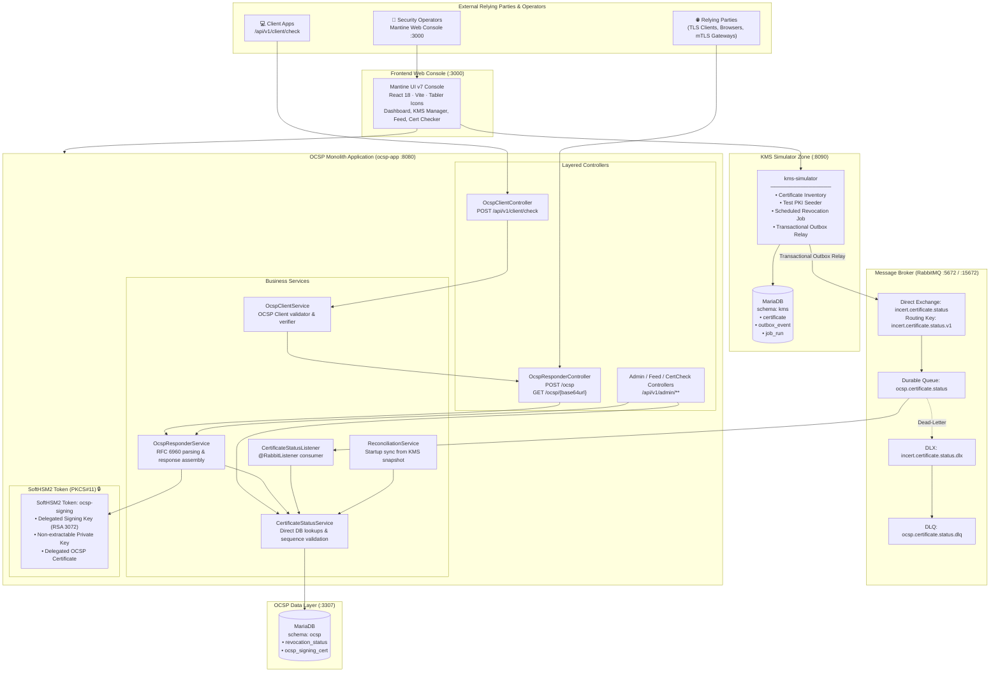
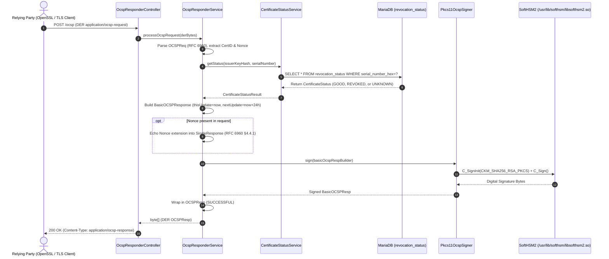
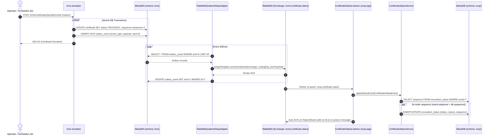
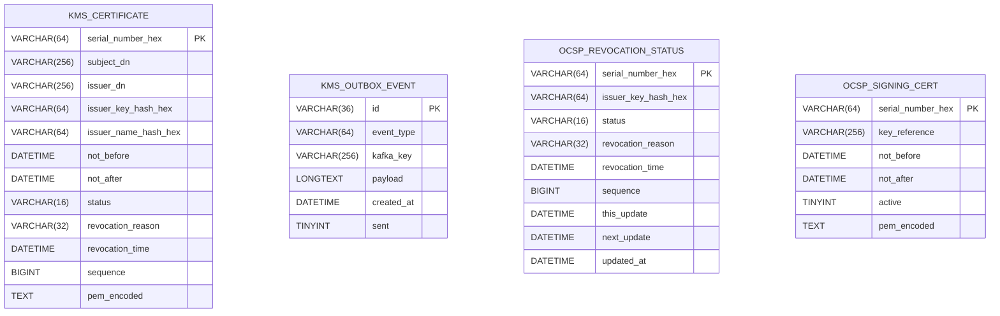
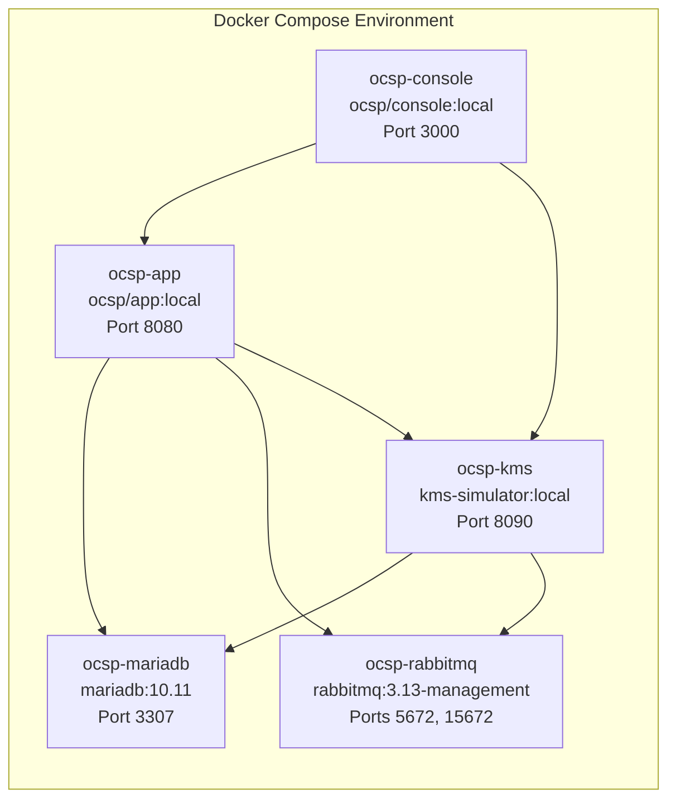

# Incert OCSP Subsystem — Architecture & Blueprint (v3.0)

> **Version**: 3.0 · **Architecture**: Layered Monolith · **Stack**: Java 21 · Spring Boot 3.3 · RabbitMQ 3.13 · SoftHSM2 (PKCS#11) · MariaDB 10.11 · Mantine UI v7 (React 18)

---

## Table of Contents
1. [Target System Blueprint](#1-target-system-blueprint)
2. [Sequence: OCSP Request Processing & PKCS#11 Dynamic Signing](#2-sequence-ocsp-request-processing--pkcs11-dynamic-signing)
3. [Sequence: Certificate Revocation via Transactional Outbox & RabbitMQ](#3-sequence-certificate-revocation-via-transactional-outbox--rabbitmq)
4. [OCSP Client & Relying Party Verification Flow](#4-ocsp-client--relying-party-verification-flow)
5. [Database Data Models (ERDs)](#5-database-data-models-erds)
6. [RabbitMQ Messaging Topology](#6-rabbitmq-messaging-topology)
7. [Deployment Blueprint](#7-deployment-blueprint)
8. [Security & Cryptographic Boundary Diagram](#8-security--cryptographic-boundary-diagram)

---

## 1. Target System Blueprint

---

## 2. Sequence: OCSP Request Processing & PKCS#11 Dynamic Signing

Every OCSP request (whether containing a nonce or nonce-free) queries the MariaDB `revocation_status` table directly and is dynamically signed by SoftHSM2 via PKCS#11. No caching layer is present, ensuring real-time revocation consistency and zero stale responses.

---

## 3. Sequence: Certificate Revocation via Transactional Outbox & RabbitMQ

---

## 4. OCSP Client & Relying Party Verification Flow

The monolith includes a built-in RFC 6960 OCSP Client service (`OcspClientService`) accessible via `POST /api/v1/client/check`:

1. **Request Construction**: Builds an RFC 6960 `OCSPReq` using Bouncy Castle, creating the target `CertID` (SHA-1 over Issuer Name and Public Key). Generates an optional cryptographically secure random nonce.
2. **HTTP Dispatch**: Transports the DER request via HTTP `POST` or `GET` (base64url) to the OCSP responder endpoint.
3. **Response Parsing & Status Validation**: Decodes the `OCSPResp` and validates `responseStatus == SUCCESSFUL`.
4. **Signature Verification**: Verifies the RSA-SHA256 signature against the responder's public key certificate.
5. **Delegated Signer Authorization**: Enforces RFC 6960 §4.2.2.2 (responder cert must contain `id-kp-OCSPSigning` Extended Key Usage and be issued by the target CA).
6. **Freshness & Nonce Matching**: Ensures `thisUpdate <= now <= nextUpdate` and verifies that the echoed nonce matches the transmitted nonce.

---

## 5. Database Data Models (ERDs)

---

## 6. RabbitMQ Messaging Topology

| Component | Identifier | Details |
|---|---|---|
| **Direct Exchange** | `incert.certificate.status` | Durable direct exchange for PKI events |
| **Routing Key** | `incert.certificate.status.v1` | Routing key for status update events |
| **Durable Queue** | `ocsp.certificate.status` | Consumer queue with DLX bound |
| **Dead-Letter Exchange (DLX)** | `incert.certificate.status.dlx` | Direct exchange for rejected/poison messages |
| **Dead-Letter Queue (DLQ)** | `ocsp.certificate.status.dlq` | Durable queue capturing failed consumer deliveries |

---

## 7. Deployment Blueprint

---

## 8. Security & Cryptographic Boundary Diagram

- **Non-Extractable Keys**: The OCSP signing private key is generated directly inside the SoftHSM2 token (`CKA_EXTRACTABLE = FALSE`). Private key material never exists in application memory or container filesystem.
- **Audit & Protection**: Any compromised certificate is revoked in KMS, persisted via Transactional Outbox, published to RabbitMQ, and updated in MariaDB within milliseconds.
