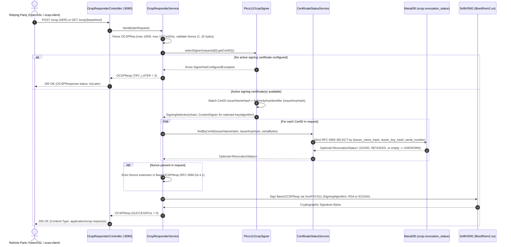
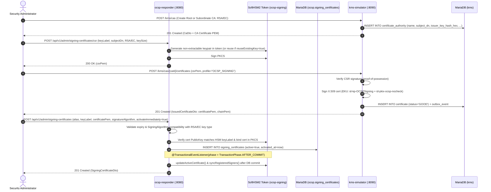
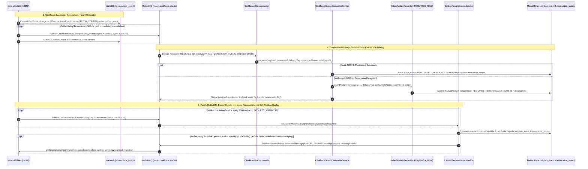
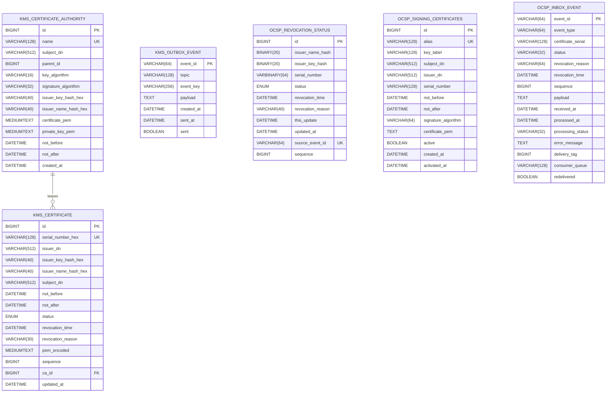
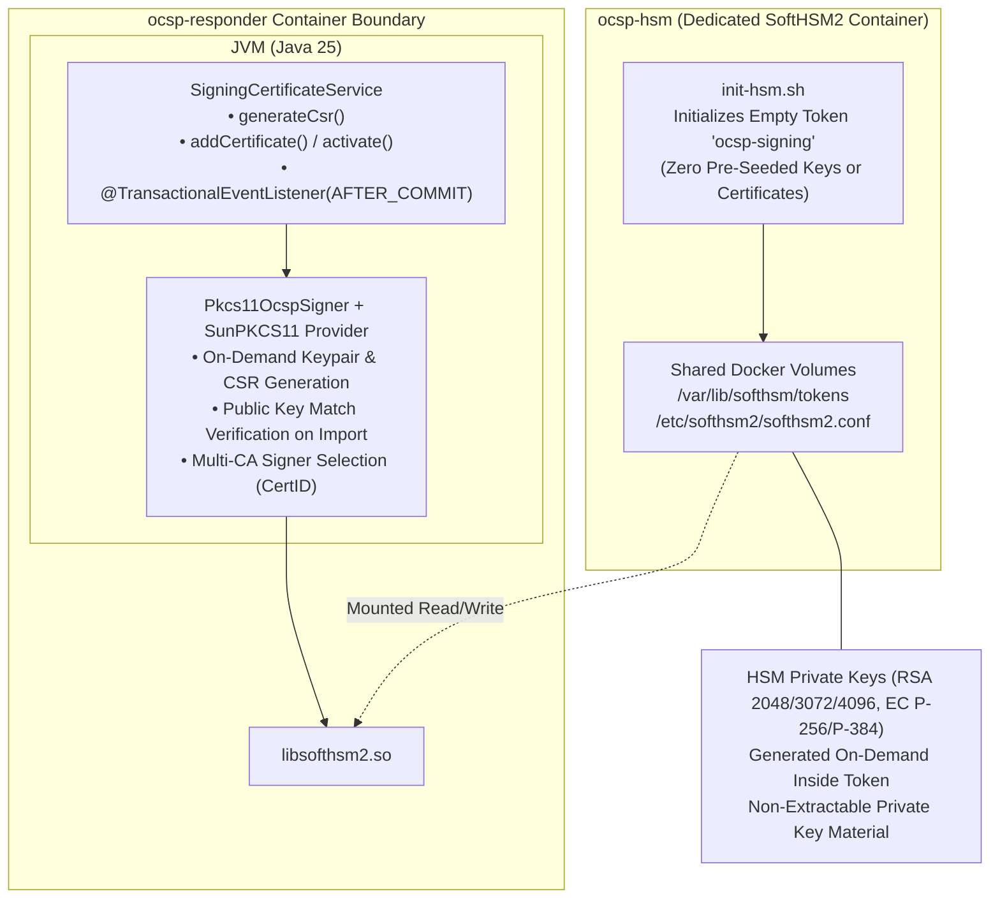

# Incert OCSP Subsystem — Architecture & Blueprint (v5.0)

> **Version**: 5.0 · **Architecture**: Decoupled Standalone Services & Zero-REST RabbitMQ Event Bus · **Stack**: Java 25 · Spring Boot 4.0 · RabbitMQ 3.13 (Strict mTLS) · SoftHSM2 (PKCS#11) · Keycloak 24 · MariaDB 10.11 · React 18 · Mantine UI v7

---

## Table of Contents
1. [Target System Blueprint](#1-target-system-blueprint)
2. [Sequence: Multi-CA OCSP Request Processing & PKCS#11 Dynamic Signing](#2-sequence-multi-ca-ocsp-request-processing--pkcs11-dynamic-signing)
3. [Sequence: HSM CSR Generation, KMS CA Issuance & Post-Commit Signer Activation](#3-sequence-hsm-csr-generation-kms-ca-issuance--post-commit-signer-activation)
4. [Sequence: Transactional Outbox, Inbox Failure Tracking & Zero-REST RabbitMQ Reconciliation](#4-sequence-transactional-outbox-inbox-failure-tracking--zero-rest-rabbitmq-reconciliation)
5. [Standalone OCSP Client & Relying Party Verification Flow](#5-standalone-ocsp-client--relying-party-verification-flow)
6. [Authentication, Authorization & Runtime TLS Management](#6-authentication-authorization--runtime-tls-management)
7. [Database Data Models (ERDs)](#7-database-data-models-erds)
8. [RabbitMQ Messaging Topology & mTLS](#8-rabbitmq-messaging-topology--mtls)
9. [Deployment Blueprint (Docker Compose Topology)](#9-deployment-blueprint-docker-compose-topology)
10. [Security & Cryptographic HSM Boundary](#10-security--cryptographic-hsm-boundary)
11. [Pragmatic Layered Architecture & Pluggable Boundary Adapters](#11-pragmatic-layered-architecture--pluggable-boundary-adapters)

---

## 1. Target System Blueprint

```mermaid
graph TB
    subgraph EXTERNAL["External Relying Parties & Operators"]
        RP["Relying Parties<br/>(TLS Clients, Browsers, mTLS Gateways)"]
        CLIENT_USER["Client Testers<br/>http://localhost:8082"]
        OPS["OCSP Operators<br/>OCSP Console :3000"]
        KMS_OPS["PKI Operators<br/>KMS Console :3001"]
    end

    subgraph KMS_ZONE["KMS Simulator Zone (:8090 / :3001 / :3308)"]
        KMS_UI["kms-console (:3001)<br/>React 18 + Mantine v7<br/>• Certificate Authorities (/cas)<br/>• Certificate Inventory (/)<br/>• Outbox Monitor (/outbox)"]
        KMS["kms-simulator (:8090)<br/>────────────────<br/>• CertificateAuthorityService (Root & Sub CAs)<br/>• CSR Proof-of-Possession & Cert Issuance<br/>• RevocationService (Revoke / Hold / Unrevoke)<br/>• OutboxRelayService (500ms @Scheduled)<br/>• KmsReconciliationService (3s Manifest & Replay)"]
        KMS_DB[("kms-mariadb (:3308)<br/>schema: kms<br/>• certificate_authority<br/>• certificate<br/>• outbox_event")]
        KMS_UI -->|/api/kms/**| KMS
        KMS --> KMS_DB
    end

    subgraph BROKER["Message Broker (RabbitMQ :5671 mTLS / :5672 / :15672)"]
        EXCHANGE["Direct Exchange: incert.certificate.status"]
        QUEUE_STATUS["Queue: ocsp.certificate.status<br/>Routing Key: incert.certificate.status.v1"]
        QUEUE_MANIFEST["Queue: ocsp.reconciliation.manifest<br/>Routing Key: incert.reconciliation.manifest.v1"]
        QUEUE_REQ["Queue: kms.reconciliation.request<br/>Routing Key: incert.reconciliation.request.v1"]
        DLX["DLX: incert.certificate.status.dlx"]
        DLQ["DLQ: ocsp.certificate.status.dlq"]
        EXCHANGE --> QUEUE_STATUS
        EXCHANGE --> QUEUE_MANIFEST
        EXCHANGE --> QUEUE_REQ
        QUEUE_STATUS -.->|Dead-Letter on Rollback| DLX --> DLQ
    end

    subgraph IAM["Identity & Access Management"]
        KEYCLOAK["Keycloak (:8081)<br/>Realm: incert<br/>Groups: administrators, operators, auditors"]
    end

    subgraph RESPONDER_APP["OCSP Responder Service (ocsp-responder :8080)"]
        subgraph SECURITY_LAYER["Spring Security Gate (KEYCLOAK / SELF_MANAGED)"]
            AUTH_CTRL["AuthController<br/>/api/v1/auth/login, /config, /tls"]
            API_KEY_FILTER["ApiKeyAuthFilter<br/>X-API-KEY validation"]
            JWT_DECODER["KeycloakJwtAuthenticationConverter<br/>OAuth2 / OIDC Bearer JWT"]
        end

        subgraph RESP_CONTROLLERS["Protocol & Admin Controllers"]
            RESP_CTRL["OcspResponderController<br/>POST /ocsp (DER)<br/>GET /ocsp/{base64url}"]
            SIGN_CTRL["SigningCertificateController<br/>/api/v1/admin/signing-certificates/**"]
            INBOX_CTRL["InboxAdminController<br/>/api/v1/admin/inbox/**<br/>/api/v1/admin/reconciliation/**"]
            ADMIN_CTRL["AdminDashboard / CertCheck / Feed<br/>/api/v1/admin/**"]
        end

        subgraph RESP_SERVICES["Business Logic & Event Consumers"]
            RESP_SVC["OcspResponderService<br/>RFC 6960 Parser, Nonce & Response Builder"]
            SIGN_SVC["SigningCertificateService<br/>HSM CSR, Cert Import, AFTER_COMMIT Sync"]
            STATUS_SVC["CertificateStatusService<br/>CertID + Serial Fallback & Sequence Guard"]
            CONSUMER["CertificateStatusConsumerService<br/>Transactional Inbox & Idempotency"]
            FAIL_REC["InboxFailureRecorder<br/>REQUIRES_NEW Failure & AMQP Tag Logger"]
            RECON_SVC["OutboxReconciliationService<br/>Zero-REST Outbox vs Inbox Diff & Replay"]
            LISTENER["CertificateStatusListener<br/>@RabbitListener (MESSAGE_ID, DELIVERY_TAG)"]
            LISTENER --> CONSUMER
            CONSUMER --> STATUS_SVC
            CONSUMER --> FAIL_REC
        end

        subgraph HSM_ZONE["Cryptographic HSM Boundary"]
            SIGNER_IFACE["OcspSigner + SigningAlgorithm Enum<br/>(RSA & ECDSA Algorithms)"]
            PKCS11_ADAPTER["Pkcs11OcspSigner<br/>Multi-CA Signer Selection & SunPKCS11"]
            TOKEN["SoftHSM2 Token: ocsp-signing<br/>• Empty Token on Init (No Pre-Seeded Keys)<br/>• On-Demand Non-Extractable RSA/EC Keys"]
            SIGNER_IFACE --> PKCS11_ADAPTER
            PKCS11_ADAPTER --> TOKEN
        end

        RESP_CTRL --> RESP_SVC
        SIGN_CTRL --> SIGN_SVC
        INBOX_CTRL --> RECON_SVC
        ADMIN_CTRL --> STATUS_SVC
        RESP_SVC --> STATUS_SVC
        RESP_SVC --> SIGNER_IFACE
        SIGN_SVC --> SIGNER_IFACE
    end

    subgraph CLIENT_APP["OCSP Client & Verifier Service (ocsp-client :8082)"]
        CLIENT_UI["Embedded Test Web UI (:8082)"]
        CLIENT_CTRL["OcspClientController<br/>POST /api/v1/client/check"]
        CLIENT_SVC["OcspClientService<br/>• RFC 6960 CertID Builder (with issuerPem)<br/>• Optional 8-Byte Nonce<br/>• POST (DER) / GET (Base64URL)<br/>• CA & Delegated Responder Signature Verifier"]
        CLIENT_UI --> CLIENT_CTRL --> CLIENT_SVC
    end

    subgraph DB["OCSP Data Layer (:3307)"]
        OCSP_DB[("ocsp-mariadb (:3307)<br/>schema: ocsp<br/>• revocation_status<br/>• signing_certificates<br/>• inbox_event")]
        STATUS_SVC --> OCSP_DB
        SIGN_SVC --> OCSP_DB
        CONSUMER --> OCSP_DB
        FAIL_REC --> OCSP_DB
        RECON_SVC --> OCSP_DB
    end

    subgraph CONSOLE["OCSP Admin Console (:3000)"]
        OCSP_UI["ocsp-console (:3000)<br/>React 18 + Mantine v7<br/>• Dashboard & Revocations<br/>• Multi-CA Signing Certificates & HSM CSR<br/>• Live Inbox Audit (3s Auto-Refresh) & Replay<br/>• Cert Checker (with Issuer CA PEM)"]
    end

    RP --> RESP_CTRL
    CLIENT_USER --> CLIENT_UI
    CLIENT_SVC -->|RFC 6960 /ocsp| RESP_CTRL
    OPS --> OCSP_UI
    KMS_OPS --> KMS_UI
    OCSP_UI -->|Admin API + JWT/Key| RESPONDER_APP
    OCSP_UI -->|OIDC SSO| KEYCLOAK
    OCSP_UI -->|Live OCSP Check| CLIENT_APP
    JWT_DECODER -->|JWKS Validation| KEYCLOAK
    KMS -->|Publish Status & Manifest| EXCHANGE
    QUEUE_STATUS --> LISTENER
    QUEUE_MANIFEST --> RECON_SVC
    RECON_SVC -->|REQUEST_MANIFEST / REPLAY_EVENTS| EXCHANGE
    QUEUE_REQ --> KMS
```

---

## 2. Sequence: Multi-CA OCSP Request Processing & PKCS#11 Dynamic Signing

Every OCSP request is validated, matched against the issuing CA's active signing certificate (`OcspSigner.selectSigner(CertID)`), resolved directly from MariaDB (`revocation_status`), and signed inside SoftHSM2 via PKCS#11. If no signing certificate has been configured and activated yet, the responder returns RFC 6960 `TRY_LATER` (`status = 3`).

---

## 3. Sequence: HSM CSR Generation, KMS CA Issuance & Post-Commit Signer Activation

Neither `ocsp-hsm` nor `kms-simulator` pre-seeds any keys, CAs, or certificates. Below is the complete end-to-end provisioning flow:

---

## 4. Sequence: Transactional Outbox, Inbox Failure Tracking & Zero-REST RabbitMQ Reconciliation

All communication between `kms-simulator` and `ocsp-responder` happens exclusively over RabbitMQ (zero HTTP/REST calls between the two services).

---

## 5. Standalone OCSP Client & Relying Party Verification Flow

`ocsp-client` (`:8082`) is a standalone relying-party service and interactive test UI:
1. **RFC 6960 Request Construction**:
   - Accepts the target certificate (or `serialHex`) and the issuing CA certificate (`issuerPem`, pasted once in **OCSP Console -> Cert Checker** and persisted in browser `localStorage`, or submitted via `/api/v1/client/check`).
   - Computes SHA-1 `issuerNameHash` and `issuerKeyHash` to construct the `CertID`.
   - Optionally injects an 8-byte cryptographically random Nonce extension (`1.3.6.1.5.5.7.48.1.2`).
2. **Transport Support**:
   - HTTP `POST /ocsp` (`Content-Type: application/ocsp-request`)
   - HTTP `GET /ocsp/{base64UrlEncodedRequest}`
3. **Cryptographic & RFC 6960 Verification**:
   - Verifies OCSP response status (`SUCCESSFUL`, `TRY_LATER`, `MALFORMED_REQUEST`, etc.).
   - Validates the responder's digital signature (RSA or ECDSA) against the issuing CA certificate or a delegated OCSP responder certificate signed by the CA with `id-kp-OCSPSigning`.
   - Verifies validity window (`thisUpdate` / `nextUpdate`) and exact Nonce echo (`nonceSent == nonceEchoed`).

---

## 6. Authentication, Authorization & Runtime TLS Management

- **Dual Authentication Modes (`security.auth-mode`)**:
  - **`KEYCLOAK` (default in Docker)**: Validates OAuth2 / OIDC Bearer JWTs issued by Keycloak (`http://localhost:8081/realms/incert`) and maps Keycloak groups (`/ocsp-administrators`, `/ocsp-operators`, `/ocsp-auditors`) to Spring Security roles.
  - **`SELF_MANAGED`**: Local credential authentication without requiring an external Keycloak instance.
- **Machine & Break-Glass Access**:
  - `X-API-KEY: incert-admin-secret-key`
  - HTTP Basic Auth (`admin:changeme`)
- **Runtime Login TLS Activation / Deactivation**:
  - `GET /api/v1/auth/tls` and `POST /api/v1/auth/tls` (`{"enabled": true|false}`) allow toggling mTLS client-certificate login (`POST /api/v1/auth/login` with `clientCert`) at runtime without restarting `ocsp-responder`.

---

## 7. Database Data Models (ERDs)

---

## 8. RabbitMQ Messaging Topology & mTLS

| Component | Identifier | Purpose |
|---|---|---|
| **Direct Exchange** | `incert.certificate.status` | Durable direct exchange shared by KMS and OCSP Responder |
| **Status Queue & Key** | Queue: `ocsp.certificate.status` Key: `incert.certificate.status.v1` | Carries `CertificateStatusChanged` events (`AMQP messageId = outbox_event.event_id`) from KMS to OCSP Responder |
| **Dead-Letter Exchange & Queue** | DLX: `incert.certificate.status.dlx` DLQ: `ocsp.certificate.status.dlq` | Captures poison/malformed messages rejected by `CertificateStatusConsumerService` (while `InboxFailureRecorder` records a `FAILED` row in `ocsp.inbox_event`) |
| **Reconciliation Manifest Queue & Key** | Queue: `ocsp.reconciliation.manifest` Key: `incert.reconciliation.manifest.v1` | Carries `OutboxManifestEvent` broadcasts (every 3s and on demand) from KMS to OCSP Responder |
| **Reconciliation Command Queue & Key** | Queue: `kms.reconciliation.request` Key: `incert.reconciliation.request.v1` | Carries `ReconciliationCommandMessage` (`REQUEST_MANIFEST` / `REPLAY_EVENTS`) from OCSP Responder to KMS |
| **Transport Security** | Port `5671` (mTLS) / Port `5672` (Plaintext) / Port `15672` (Management UI) | Strict mutual TLS by default (`RABBITMQ_TLS_ENABLED=true`); automatic fallback to `5672` when `false`. Broker credentials: `ocsp_amqp` / `changeme`. |

---

## 9. Deployment Blueprint (Docker Compose Topology)

The subsystem is deployed across two standalone Docker Compose stacks sharing the external bridge network `ocsp-net`:

1. **`OCSP/docker-compose.yml` (7 containers)**:
   - `ocsp-mariadb` (`:3307 -> 3306`, schema `ocsp`)
   - `ocsp-rabbitmq` (`:5671`, `:5672`, `:15672`)
   - `ocsp-keycloak` (`:8081`)
   - `ocsp-hsm` (SoftHSM2 container initializing empty token `ocsp-signing` on shared volumes `hsm-tokens` and `hsm-conf`)
   - `ocsp-responder` (`:8080`, mounts `hsm-tokens` and `hsm-conf` to access SoftHSM2 via `libsofthsm2.so`)
   - `ocsp-client` (`:8082`)
   - `ocsp-console` (`:3000 -> 80`)
2. **`kms-simulator/docker-compose.yml` (3 containers on `ocsp-net`)**:
   - `kms-mariadb` (`:3308 -> 3306`, schema `kms`)
   - `kms-simulator` (`:8090`)
   - `kms-console` (`:3001 -> 80`)

---

## 10. Security & Cryptographic HSM Boundary

- **Zero Pre-Seeded Keys**: `init-hsm.sh` initializes only the SoftHSM2 slot/token (`ocsp-signing`). All signing keys are created on demand by the administrator via `generateCsr` and bound to CA-issued certificates via `importCertificateToToken`.
- **Production Guard (`@Profile("!prod")`)**: `SoftwareKeyOcspSigner` is disabled in the `prod` profile; production deployments strictly require PKCS#11 HSM connectivity.
- **Post-Commit Consistency**: In-memory HSM signer state is updated via `@TransactionalEventListener(phase = TransactionPhase.AFTER_COMMIT)` so a database rollback can never leave the HSM signer and `ocsp.signing_certificates` out of sync.

---

## 11. Pragmatic Layered Architecture & Pluggable Boundary Adapters

The codebase uses standard Spring layered architecture (`controller` -> `service` -> `repository`) and places interfaces strictly at external infrastructure boundaries:

1. **Cryptographic HSM Adapter (`OcspSigner`)**:
   - Implemented by `Pkcs11OcspSigner` (SoftHSM2 / hardware PKCS#11 HSM) and `SoftwareKeyOcspSigner` (`@Profile("!prod")` test fallback), backed by the centralized `SigningAlgorithm` enum.
2. **Event Publisher Adapter (`CertificateEventPublisher`)**:
   - Implemented by `RabbitMqCertificateEventPublisher` (sets AMQP `messageId = eventId` for end-to-end Outbox–Inbox traceability).
3. **Event Consumer Adapter (`CertificateStatusConsumer`)**:
   - Invoked by `CertificateStatusListener` (`@RabbitListener`) and implemented by `CertificateStatusConsumerService` + `InboxFailureRecorder` (`Propagation.REQUIRES_NEW`).
