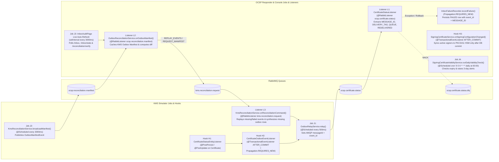
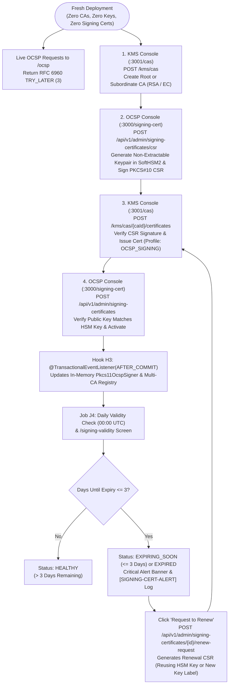
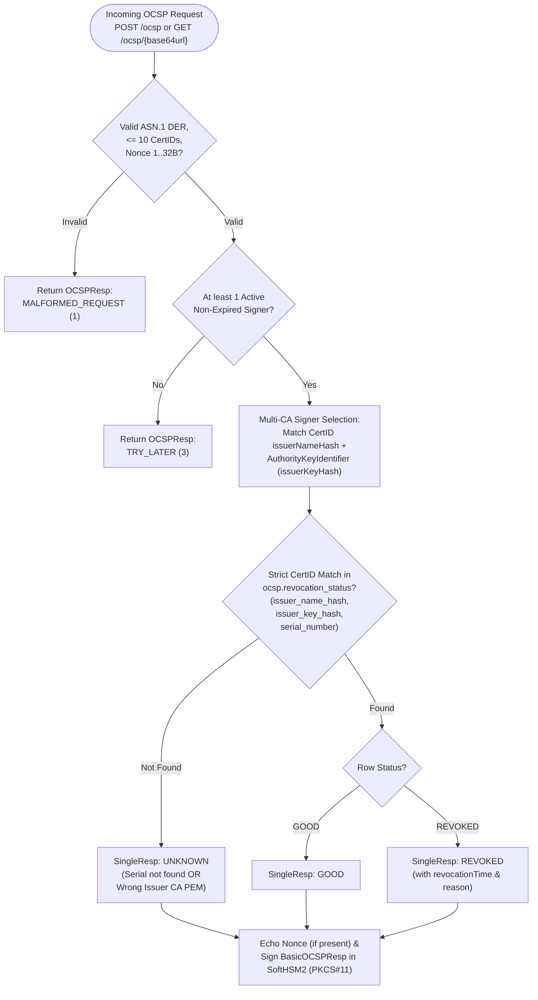

# Incert OCSP Subsystem — Architectural Floorplan & Visual Workflows (v5.0)

This document maps out the complete **System Floorplan** (zones, rooms, ports, data stores, cryptographic boundaries, message queues, and background jobs) along with visual flowcharts for every functional case.

---

## 1. Master System Floorplan (Zones, Ports & Boundaries)

```mermaid
flowchart TB
    subgraph ZONE_EXTERNAL["Zone 1: External Relying Parties & Operators"]
        RP["Relying Parties\n(Browsers, TLS Gateways, mTLS Services)"]
        TESTER["OCSP Client Tester\n(http://localhost:8082)"]
        OCSP_ADMIN["OCSP Security Admin\n(http://localhost:3002)"]
        KMS_ADMIN["PKI / CA Operator\n(http://localhost:3001)"]
    end

    subgraph ZONE_UI["Zone 2: Presentation & Admin Consoles"]
        subgraph ROOM_OCSP_UI["ocsp-console (:3000 - React 18 / Mantine v7)"]
            UI_DASH["/dashboard\nLive Telemetry & Health"]
            UI_INBOX["/inbox\nLive 3s Auto-Refresh Audit\n& RabbitMQ Replay"]
            UI_REV["/revocations\nRevocation Feed"]
            UI_SIGN["/signing-cert\nMulti-CA Signers & HSM CSR"]
            UI_VALID["/signing-validity\nDaily Validity Monitor,\n3-Day Alert & Renewal CSR"]
            UI_CHECK["/cert-checker\nLive RFC 6960 Tester\n(with Issuer CA PEM)"]
        end

        subgraph ROOM_KMS_UI["kms-console (:3001 - React 18 / Mantine v7)"]
            KUI_CAS["/cas\nCreate Root & Sub CAs\nIssue Certs from CSR"]
            KUI_INV["/\nCertificate Inventory\nRevoke / Hold / Unrevoke"]
            KUI_OUT["/outbox\nTransactional Outbox Monitor"]
        end
    end

    subgraph ZONE_IAM["Zone 3: Identity & Access Management"]
        KC["ocsp-keycloak (:8081)\nRealm: incert\nGroups: /ocsp-administrators,\n/ocsp-operators, /ocsp-auditors"]
    end

    subgraph ZONE_KMS["Zone 4: KMS & Certificate Authority Engine (:8090 / :3308)"]
        KMS_CA_SVC["CertificateAuthorityService\n• Create Root / Subordinate CA\n• Verify CSR Proof-of-Possession\n• Issue OCSP_SIGNING, TLS_SERVER,\n  TLS_CLIENT, GENERIC Certs"]
        KMS_REV_SVC["RevocationService\n• Revoke / Hold / Unrevoke\n• Monotonic Sequence Counter"]
        KMS_HOOKS["JPA @PostPersist/@PostUpdate\n-> @TransactionalEventListener(AFTER_COMMIT)\nCertificateOutboxEventListener"]
        KMS_JOB_RELAY["Job J1: OutboxRelayService\n@Scheduled(500ms)\nStrict Ordering Relay"]
        KMS_JOB_MAN["Job J2: KmsReconciliationService\n@Scheduled(3000ms) Manifest Broadcast\n& @RabbitListener Replay Handler"]
        KMS_DB[("kms-mariadb (:3308)\nSchema: kms\n• certificate_authority\n• certificate\n• outbox_event")]

        KMS_CA_SVC --> KMS_DB
        KMS_REV_SVC --> KMS_DB
        KMS_CA_SVC --> KMS_HOOKS
        KMS_REV_SVC --> KMS_HOOKS
        KMS_HOOKS --> KMS_DB
        KMS_JOB_RELAY --> KMS_DB
        KMS_JOB_MAN --> KMS_DB
    end

    subgraph ZONE_BROKER["Zone 5: RabbitMQ Event & Reconciliation Bus (:5671 mTLS / :5672 / :15672)"]
        EX["Direct Exchange: incert.certificate.status"]
        Q_STATUS["Queue: ocsp.certificate.status\nKey: incert.certificate.status.v1\nHeader: MESSAGE_ID = event_id"]
        Q_DLQ["DLX/DLQ: ocsp.certificate.status.dlq\n(Poison / Failed Payloads)"]
        Q_MAN["Queue: ocsp.reconciliation.manifest\nKey: incert.reconciliation.manifest.v1\n(OutboxManifestEvent)"]
        Q_REQ["Queue: kms.reconciliation.request\nKey: incert.reconciliation.request.v1\n(REQUEST_MANIFEST / REPLAY_EVENTS)"]

        EX --> Q_STATUS
        Q_STATUS -.->|Rollback / NACK| Q_DLQ
        EX --> Q_MAN
        EX --> Q_REQ
    end

    subgraph ZONE_RESPONDER["Zone 6: OCSP Responder Core (:8080 / :3307)"]
        OCSP_SEC["Security Gate\nKEYCLOAK JWT / SELF_MANAGED\nX-API-KEY / Basic / Runtime mTLS Toggle"]
        OCSP_PROTO["OcspResponderService\n• RFC 6960 POST & GET\n• Nonce Echo (1..32B)\n• Strict CertID Lookup\n• TRY_LATER if No Signer"]
        OCSP_SIGN_SVC["SigningCertificateService\n• HSM CSR Generation\n• Public Key Match Check\n• @TransactionalEventListener(AFTER_COMMIT)"]
        OCSP_JOB_VAL["Job J4: SigningCertificateValidityService\n@Scheduled(0 0 0 * * *)\nDaily Check, 3-Day Alert & Renewal CSR"]
        OCSP_CONS["Listener L1: CertificateStatusListener\n-> CertificateStatusConsumerService\n+ InboxFailureRecorder (REQUIRES_NEW)"]
        OCSP_RECON["Listener L2: OutboxReconciliationService\nZero-REST Outbox vs Inbox Diff\n& RabbitMQ Replay Publisher"]
        OCSP_DB[("ocsp-mariadb (:3307)\nSchema: ocsp\n• revocation_status\n• signing_certificates\n• inbox_event")]

        OCSP_PROTO --> OCSP_DB
        OCSP_SIGN_SVC --> OCSP_DB
        OCSP_JOB_VAL --> OCSP_DB
        OCSP_CONS --> OCSP_DB
        OCSP_RECON --> OCSP_DB
    end

    subgraph ZONE_HSM["Zone 7: Cryptographic HSM Boundary (ocsp-hsm)"]
        HSM_TOKEN["SoftHSM2 Token: ocsp-signing\nShared Volumes: hsm-tokens, hsm-conf\n• Empty on Init (Zero Static Keys)\n• On-Demand Non-Extractable RSA/EC Keys\n• Multi-CA Signer Selection by CertID"]
    end

    subgraph ZONE_CLIENT["Zone 8: Standalone OCSP Verifier (ocsp-client :8082)"]
        CLIENT_ENGINE["OcspClientService\nBuilds CertID from Issuer CA PEM,\nVerifies OCSP Signature, EKU & Nonce"]
    end

    RP --> OCSP_PROTO
    TESTER --> CLIENT_ENGINE --> OCSP_PROTO
    OCSP_ADMIN --> ROOM_OCSP_UI
    KMS_ADMIN --> ROOM_KMS_UI
    ROOM_OCSP_UI --> OCSP_SEC
    ROOM_OCSP_UI --> CLIENT_ENGINE
    ROOM_OCSP_UI --> KC
    OCSP_SEC --> KC
    ROOM_KMS_UI --> KMS_CA_SVC
    ROOM_KMS_UI --> KMS_REV_SVC
    KMS_JOB_RELAY -->|mTLS 5671| EX
    KMS_JOB_MAN -->|mTLS 5671| EX
    Q_STATUS --> OCSP_CONS
    Q_MAN --> OCSP_RECON
    OCSP_RECON -->|mTLS 5671| EX
    Q_REQ --> KMS_JOB_MAN
    OCSP_PROTO --> HSM_TOKEN
    OCSP_SIGN_SVC --> HSM_TOKEN
```



---

## 2. Floorplan of All Background Jobs & Event Listeners



---

## 3. Functional Case Floorplan: End-to-End Decision Flows

### 3.1 CA Creation, HSM Key/CSR Generation, Signing Cert Activation & Renewal Flow



### 3.2 Live RFC 6960 OCSP Request Decision Floorplan



### 3.3 Zero-REST Outbox ↔ Inbox Reconciliation & Self-Healing Replay Floorplan

```mermaid
flowchart TD
    KMS_OUTBOX[("kms.outbox_event\n& kms.certificate")]
    MANIFEST["Job J2 (Every 3s):\nBroadcast OutboxManifestEvent\nto ocsp.reconciliation.manifest"]
    VERIFY["OCSP Responder:\nGET /api/v1/admin/reconciliation/verify\nCompares Manifest vs ocsp.inbox_event & revocation_status"]
    SYNC_CHECK{"Any Missing, Failed,\nor Mismatched Events?"}
    IN_SYNC["100% SYNCHRONIZED\n(synchronized = true)"]
    DIFF["Discrepancy Detected:\n• missingInInboxEventIds\n• failedInInboxEventIds\n• missingSerials / statusMismatches"]
    REPLAY_CMD["POST /api/v1/admin/reconciliation/replay\nPublishes REPLAY_EVENTS Command\nto kms.reconciliation.request"]
    KMS_REPLAY{"Does Serial Exist\nin kms.outbox_event?"}
    REPUBLISH["Re-Publish Existing OutboxEvent\nto ocsp.certificate.status"]
    SYNTHESIZE["Synthesize New OutboxEvent from kms.certificate,\nSave to kms.outbox_event & Publish to RabbitMQ"]

    KMS_OUTBOX --> MANIFEST --> VERIFY --> SYNC_CHECK
    SYNC_CHECK -->|No| IN_SYNC
    SYNC_CHECK -->|Yes| DIFF --> REPLAY_CMD --> KMS_REPLAY
    KMS_REPLAY -->|Yes| REPUBLISH --> VERIFY
    KMS_REPLAY -->|No (Missing from Outbox)| SYNTHESIZE --> VERIFY
```

---

## 4. Zone-by-Zone Reference Table

| Zone | Component | Port / Queue | Key Classes / Files |
|---|---|---|---|
| **Zone 2 (UI)** | `ocsp-console` | `:3002` | `SigningCertificatesPage.js`, `SigningCertValidityPage.js`, `InboxAuditPage.js`, `CertCheckerPage.js` |
| **Zone 2 (UI)** | `kms-console` | `:3001` | `CertificateAuthoritiesPage.tsx`, `KmsCertificatesPage.tsx`, `OutboxMonitorPage.tsx` |
| **Zone 3 (IAM)** | `ocsp-keycloak` | `:8081` | Realm `incert` (`/ocsp-administrators`, `/ocsp-operators`, `/ocsp-auditors`) |
| **Zone 4 (KMS)** | `kms-simulator` | `:8090` / `:3308` | `CertificateAuthorityService`, `RevocationService`, `OutboxRelayService`, `KmsReconciliationService` |
| **Zone 5 (Broker)** | `ocsp-rabbitmq` | `:5671` (mTLS), `:5672`, `:15672` | `ocsp.certificate.status`, `ocsp.certificate.status.dlq`, `ocsp.reconciliation.manifest`, `kms.reconciliation.request` |
| **Zone 6 (Responder)** | `ocsp-responder` | `:8080` / `:3307` | `OcspResponderService`, `SigningCertificateService`, `SigningCertificateValidityService`, `CertificateStatusConsumerService`, `InboxFailureRecorder`, `OutboxReconciliationService` |
| **Zone 7 (HSM)** | `ocsp-hsm` | Volumes `hsm-tokens`, `hsm-conf` | `init-hsm.sh`, `Pkcs11OcspSigner`, `SigningAlgorithm` |
| **Zone 8 (Client)** | `ocsp-client` | `:8082` | `OcspClientService`, `OcspClientController` |

