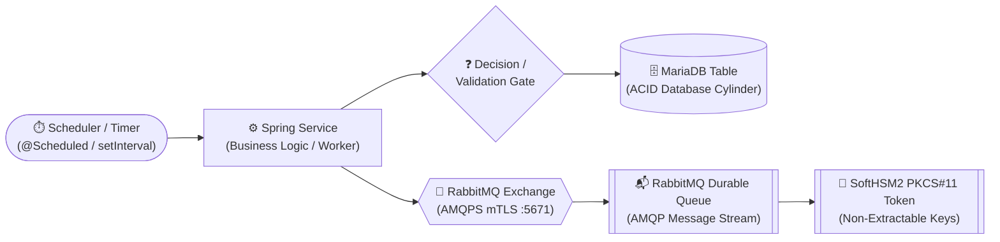
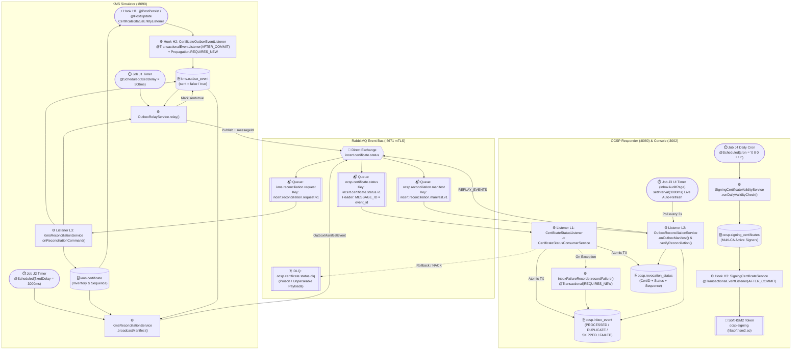

# Incert OCSP Subsystem — Background Jobs & Event Loops Architecture

This document explains **exclusively how the background jobs, scheduled tasks, RabbitMQ consumers, and transaction hooks work**, with dedicated visual graphs using distinct architectural symbols for **Databases**, **RabbitMQ Exchanges/Queues**, **Schedulers/Timers**, **Spring Services**, **Decision Gates**, and **HSM Tokens**.

---

## 0. Architectural Symbol Legend



---

## 1. Master Graph: How All Jobs Connect End-to-End



---

## 2. Job J1 (`kms-simulator`): Transactional Outbox Creation & 500ms Relay Job

**Files**:
- [CertificateStatusEntityListener.java](file:///Users/hedfimajd/kms-simulator/src/main/java/com/company/incert/kms/messaging/CertificateStatusEntityListener.java)
- [CertificateOutboxEventListener.java](file:///Users/hedfimajd/kms-simulator/src/main/java/com/company/incert/kms/messaging/CertificateOutboxEventListener.java)
- [OutboxRelayService.java](file:///Users/hedfimajd/kms-simulator/src/main/java/com/company/incert/kms/service/OutboxRelayService.java)
- [RabbitMqCertificateEventPublisher.java](file:///Users/hedfimajd/kms-simulator/src/main/java/com/company/incert/kms/messaging/rabbitmq/RabbitMqCertificateEventPublisher.java)

### Visual Execution Graph

```mermaid
flowchart TD
    MUTATION(["⚡ Certificate Issued / Revoked / Held / Unrevoked"])
    CERT_DB[("🗄️ kms.certificate\nINSERT or UPDATE\n(sequence = sequence + 1)")]
    JPA_HOOK["⚙️ Hook H1: CertificateStatusEntityListener\n@PostPersist / @PostUpdate\nChecks hasStatusOrSequenceChanged()"]
    AFTER_COMMIT["⚙️ Hook H2: CertificateOutboxEventListener\n@TransactionalEventListener(AFTER_COMMIT)\n@Transactional(REQUIRES_NEW)"]
    OUTBOX_DB[("🗄️ kms.outbox_event\nINSERT event_id (UUID),\nevent_key = issuerKeyHash:serialHex,\nsent = false")]

    TIMER(["⏱️ Job J1: OutboxRelayService.relay()\n@Scheduled(fixedDelay = 500ms)\n+ immediate call after REST mutation"])
    QUERY_PENDING["⚙️ SELECT * FROM kms.outbox_event\nWHERE sent = false\nORDER BY created_at ASC"]
    HAS_PENDING{"❓ Any unsent\nevents?"}
    IDLE(["💤 Idle until next 500ms tick"])
    PUB_SVC["⚙️ RabbitMqCertificateEventPublisher.publish()\nSets AMQP Header: messageId = event_id"]
    EXCHANGE{{"🐇 RabbitMQ Exchange\nincert.certificate.status"}}
    QUEUE[["📬 Queue: ocsp.certificate.status\nKey: incert.certificate.status.v1"]]
    PUB_OK{"❓ Broker Publish\nSucceeded?"}
    MARK_SENT[("🗄️ kms.outbox_event\nUPDATE sent = true,\nsent_at = Instant.now()")]
    BREAK_BATCH["🛑 STOP BATCH IMMEDIATELY (break)\nPreserves strict per-certificate ordering;\nretries on next 500ms tick"]

    MUTATION --> CERT_DB --> JPA_HOOK --> AFTER_COMMIT --> OUTBOX_DB
    TIMER --> QUERY_PENDING
    OUTBOX_DB --> QUERY_PENDING --> HAS_PENDING
    HAS_PENDING -->|No| IDLE
    HAS_PENDING -->|Yes (Loop in created_at order)| PUB_SVC
    PUB_SVC --> EXCHANGE --> QUEUE
    PUB_SVC --> PUB_OK
    PUB_OK -->|Yes| MARK_SENT
    PUB_OK -->|No (Broker Error)| BREAK_BATCH
```

### How It Works Step-by-Step
1. **Automatic Detection (`Hook H1`)**: Whenever a `Certificate` row is inserted (`@PostPersist`) or its status/sequence changes (`@PostUpdate`), `CertificateStatusEntityListener` emits a `CertificateStatusEvent` in memory.
2. **Post-Commit Outbox Persistence (`Hook H2`)**: Once the `Certificate` transaction commits (`TransactionPhase.AFTER_COMMIT`), `CertificateOutboxEventListener` opens a `REQUIRES_NEW` transaction and inserts an `OutboxEvent` into `kms.outbox_event` (`sent = false`).
3. **500ms Relay Loop (`Job J1`)**:
   - Runs every **500ms** (`@Scheduled(fixedDelayString = "${kms.outbox.relay-delay-ms:500}")`).
   - Fetches all rows where `sent = false` ordered by `created_at ASC`.
   - Publishes each event to RabbitMQ with `message.getMessageProperties().setMessageId(eventId)` so the AMQP header carries the exact `outbox_event.event_id`.
   - Marks `sent = true` and `sent_at = Instant.now()`.
   - **Strict Ordering Guard**: If RabbitMQ is unreachable or throws an exception on event $N$, the loop executes `break` immediately so event $N+1$ cannot be published ahead of event $N$.

---

## 3. Job L1 (`ocsp-responder`): Transactional Inbox Consumer & Independent Failure Recorder

**Files**:
- [CertificateStatusListener.java](file:///Users/hedfimajd/OCSP/ocsp-responder/src/main/java/com/company/incert/ocsp/messaging/CertificateStatusListener.java)
- [CertificateStatusConsumerService.java](file:///Users/hedfimajd/OCSP/ocsp-responder/src/main/java/com/company/incert/ocsp/messaging/CertificateStatusConsumerService.java)
- [InboxFailureRecorder.java](file:///Users/hedfimajd/OCSP/ocsp-responder/src/main/java/com/company/incert/ocsp/messaging/InboxFailureRecorder.java)
- [CertificateStatusService.java](file:///Users/hedfimajd/OCSP/ocsp-responder/src/main/java/com/company/incert/ocsp/service/CertificateStatusService.java)

### Visual Execution Graph

```mermaid
flowchart TD
    QUEUE[["📬 RabbitMQ Queue\nocsp.certificate.status"]]
    LISTENER["⚙️ Listener L1: CertificateStatusListener.onMessage()\nExtracts AMQP Headers:\n• MESSAGE_ID (KMS outbox event_id)\n• DELIVERY_TAG (broker offset)\n• CONSUMER_QUEUE\n• REDELIVERED"]
    PARSE{"❓ Valid JSON\nPayload?"}
    FAIL_PARSE["⚙️ InboxFailureRecorder.recordFailure()\n@Transactional(REQUIRES_NEW)"]
    INBOX_FAIL_DB[("🗄️ ocsp.inbox_event\nINSERT processing_status = 'FAILED'\nevent_id = AmqpHeaders.MESSAGE_ID\ndelivery_tag, queue, redelivered, error_message")]
    DLQ[["☠️ Dead-Letter Queue\nocsp.certificate.status.dlq"]]

    IDEMPOTENT{"❓ event_id already in\nocsp.inbox_event\nAND status != FAILED?"}
    INBOX_DUP_DB[("🗄️ ocsp.inbox_event\nUPDATE processing_status = 'DUPLICATE'\nprocessed_at = now, delivery_tag")]

    SAVE_RCV[("🗄️ ocsp.inbox_event\nSAVE processing_status = 'RECEIVED'\ndelivery_tag, consumer_queue, redelivered")]
    SEQ_CHECK{"❓ Strict CertID Lookup in\nocsp.revocation_status:\nincoming.sequence > stored.sequence?"}
    REV_DB[("🗄️ ocsp.revocation_status\nINSERT or UPDATE\n(issuer_name_hash, issuer_key_hash, serial_number)\nstatus, reason, sequence")]
    INBOX_PROC_DB[("🗄️ ocsp.inbox_event\nUPDATE processing_status = 'PROCESSED'\nprocessed_at = now")]
    INBOX_SKIP_DB[("🗄️ ocsp.inbox_event\nUPDATE processing_status = 'SKIPPED'\nprocessed_at = now")]

    QUEUE --> LISTENER --> PARSE
    PARSE -->|No (Malformed JSON)| FAIL_PARSE --> INBOX_FAIL_DB
    FAIL_PARSE -.->|Throw RuntimeException -> Rollback Main TX| DLQ
    PARSE -->|Yes| IDEMPOTENT
    IDEMPOTENT -->|Yes| INBOX_DUP_DB
    IDEMPOTENT -->|No (New or previously FAILED)| SAVE_RCV --> SEQ_CHECK
    SEQ_CHECK -->|Yes (Newer Sequence)| REV_DB --> INBOX_PROC_DB
    SEQ_CHECK -->|No (Stale / Same Sequence)| INBOX_SKIP_DB
```

### How It Works Step-by-Step
1. **Header Extraction**: `CertificateStatusListener` extracts `AmqpHeaders.MESSAGE_ID`, `DELIVERY_TAG`, `CONSUMER_QUEUE`, and `REDELIVERED` from the RabbitMQ delivery and passes them into `CertificateStatusConsumerService.consume(...)` inside a `@Transactional` boundary.
2. **Poison Message & Failure Recording (`REQUIRES_NEW`)**:
   - If JSON parsing fails (or if database processing throws an exception), `InboxFailureRecorder.recordFailure(...)` runs in an **independent transaction (`Propagation.REQUIRES_NEW`)**.
   - Because it uses `AmqpHeaders.MESSAGE_ID` as `inbox_event.event_id`, the `FAILED` row in `ocsp.inbox_event` stays linked to the exact `kms.outbox_event.event_id` even when the JSON body could not be parsed.
   - The main consumer transaction then throws `RuntimeException`, rolling back any partial work and instructing RabbitMQ to route the message to `ocsp.certificate.status.dlq`.
3. **Idempotency & Retry Support**:
   - If `eventId` already exists in `ocsp.inbox_event` with a non-`FAILED` status (`PROCESSED`, `SKIPPED`, `DUPLICATE`), it marks the row `DUPLICATE` and returns immediately.
   - If the existing row has `processing_status == FAILED`, reprocessing is allowed so a replayed event transitions cleanly from `FAILED` to `PROCESSED`.
4. **Strict CertID & Sequence Application**:
   - `CertificateStatusService.applyStatusChange` looks up the row in `ocsp.revocation_status` by the strict RFC 6960 `CertID` triple `(issuer_name_hash, issuer_key_hash, serial_number)`.
   - If `event.sequence() < row.getSequence()`, the event is stale and `inbox_event` is marked `SKIPPED`. Otherwise `ocsp.revocation_status` is inserted/updated and `inbox_event` is marked `PROCESSED` in the same transaction.

---

## 4. Jobs J2, L2, L3 & J3: Zero-REST RabbitMQ Outbox ↔ Inbox Reconciliation & Self-Healing Replay

**Files**:
- [KmsReconciliationService.java](file:///Users/hedfimajd/kms-simulator/src/main/java/com/company/incert/kms/service/KmsReconciliationService.java)
- [OutboxReconciliationService.java](file:///Users/hedfimajd/OCSP/ocsp-responder/src/main/java/com/company/incert/ocsp/service/OutboxReconciliationService.java)
- [InboxAuditPage.tsx](file:///Users/hedfimajd/OCSP/ocsp-console/src/pages/InboxAuditPage.tsx)

### Visual Execution Graph

```mermaid
flowchart TD
    subgraph KMS_RECON["KMS Simulator (Job J2 & Listener L3)"]
        J2_TIMER(["⏱️ Job J2: @Scheduled(fixedDelay = 3000ms)\nKmsReconciliationService.broadcastManifest()"])
        KMS_CERT[("🗄️ kms.certificate")]
        KMS_OUT[("🗄️ kms.outbox_event")]
        BUILD_MAN["⚙️ Build OutboxManifestEvent\n• totalOutboxEvents / sent / pending\n• outboxEventIds[]\n• certificates[]: (serial, status, seq, latestEventId)"]
        L3["⚙️ Listener L3: onReconciliationCommand()\nHandles REQUEST_MANIFEST & REPLAY_EVENTS"]
        CHECK_OUTBOX{"❓ For each missingSerial:\nDoes event exist in\nkms.outbox_event?"}
        REPUB_OUTBOX["⚙️ Re-publish existing OutboxEvent\nvia CertificateEventPublisher"]
        SYNTH_OUTBOX["⚙️ createAndPublishOutboxEventForCertificate()\nSynthesizes new OutboxEvent from kms.certificate,\nsaves to kms.outbox_event & publishes"]
    end

    subgraph BROKER["RabbitMQ Reconciliation Queues"]
        Q_MAN[["📬 Queue: ocsp.reconciliation.manifest\nKey: incert.reconciliation.manifest.v1"]]
        Q_REQ[["📬 Queue: kms.reconciliation.request\nKey: incert.reconciliation.request.v1"]]
        Q_STATUS[["📬 Queue: ocsp.certificate.status\nKey: incert.certificate.status.v1"]]
    end

    subgraph OCSP_RECON["OCSP Responder (Listener L2) & Console (Job J3)"]
        L2["⚙️ Listener L2: OutboxReconciliationService\n.onOutboxManifest()\nCaches latest OutboxManifestEvent in AtomicReference"]
        J3_UI(["⏱️ Job J3: InboxAuditPage setInterval(3000ms)\nPolls GET /api/v1/admin/reconciliation/verify"])
        OCSP_INBOX[("🗄️ ocsp.inbox_event")]
        OCSP_REV[("🗄️ ocsp.revocation_status")]
        DIFF_ENGINE["⚙️ verifyReconciliation() Diff Engine:\n1. manifest.outboxEventIds vs ocsp.inbox_event\n   -> missingInInboxEventIds & failedInInboxEventIds\n2. manifest.certificates vs ocsp.revocation_status\n   -> missingSerials & statusMismatches"]
        REPLAY_BTN(["🔘 Operator clicks 'Replay via RabbitMQ'\nPOST /api/v1/admin/reconciliation/replay"])
    end

    J2_TIMER --> BUILD_MAN
    KMS_CERT --> BUILD_MAN
    KMS_OUT --> BUILD_MAN
    BUILD_MAN --> Q_MAN --> L2

    J3_UI --> DIFF_ENGINE
    L2 --> DIFF_ENGINE
    OCSP_INBOX --> DIFF_ENGINE
    OCSP_REV --> DIFF_ENGINE

    REPLAY_BTN -->|Publishes REPLAY_EVENTS| Q_REQ --> L3
    L3 --> CHECK_OUTBOX
    CHECK_OUTBOX -->|Yes| REPUB_OUTBOX --> Q_STATUS
    CHECK_OUTBOX -->|No (Missing in Outbox Table)| SYNTH_OUTBOX --> KMS_OUT
    SYNTH_OUTBOX --> Q_STATUS
```

### How It Works Step-by-Step
1. **3-Second Outbox Manifest Broadcast (`Job J2`)**:
   - Every **3000ms**, `KmsReconciliationService.broadcastManifest()` queries `kms.certificate` and `kms.outbox_event` and publishes an `OutboxManifestEvent` to `ocsp.reconciliation.manifest`.
2. **In-Memory Manifest Cache (`Listener L2`)**:
   - `OutboxReconciliationService.onOutboxManifest()` in `ocsp-responder` consumes the manifest from RabbitMQ and stores it in `latestManifestRef`.
3. **3-Second Live UI Polling & Zero-REST Diff (`Job J3`)**:
   - `InboxAuditPage.tsx` runs a 3-second `setInterval` calling `GET /api/v1/admin/reconciliation/verify` (and `GET /api/v1/admin/inbox`).
   - `OutboxReconciliationService.verifyReconciliation()` compares the cached KMS manifest against `ocsp.inbox_event` and `ocsp.revocation_status` locally (zero HTTP calls to KMS):
     - **`missingInInboxEventIds`**: Event IDs present in `kms.outbox_event` that never arrived in `ocsp.inbox_event`.
     - **`failedInInboxEventIds`**: Event IDs in `ocsp.inbox_event` with `processing_status = FAILED`.
     - **`missingSerials` / `statusMismatches`**: Certificates in KMS missing from `ocsp.revocation_status` or with `responder.sequence < kms.sequence`.
4. **Self-Healing Replay with Missing-Outbox Synthesis (`Listener L3`)**:
   - Calling `POST /api/v1/admin/reconciliation/replay` publishes a `REPLAY_EVENTS` command containing the missing/failed `eventId`s and `serialNumberHex`s to `kms.reconciliation.request`.
   - `KmsReconciliationService.handleReplay()` in KMS consumes the command:
     - Re-publishes each requested `eventId` from `kms.outbox_event`.
     - For each requested `serial`: if an `OutboxEvent` exists in `kms.outbox_event`, re-publishes the latest one; **if no `OutboxEvent` exists in `kms.outbox_event` for that serial**, looks up the certificate in `kms.certificate`, synthesizes a brand-new `OutboxEvent`, saves it to `kms.outbox_event`, and publishes it immediately to RabbitMQ.

---

## 5. Job J4 & Hook H3 (`ocsp-responder`): Daily Signing Certificate Validity Job, 3-Day Alerting & Post-Commit HSM Sync

**Files**:
- [SigningCertificateValidityService.java](file:///Users/hedfimajd/OCSP/ocsp-responder/src/main/java/com/company/incert/ocsp/service/SigningCertificateValidityService.java)
- [SigningCertificateService.java](file:///Users/hedfimajd/OCSP/ocsp-responder/src/main/java/com/company/incert/ocsp/service/SigningCertificateService.java)
- [Pkcs11OcspSigner.java](file:///Users/hedfimajd/OCSP/ocsp-responder/src/main/java/com/company/incert/ocsp/signing/Pkcs11OcspSigner.java)
- [SigningCertValidityPage.tsx](file:///Users/hedfimajd/OCSP/ocsp-console/src/pages/SigningCertValidityPage.tsx)

### Visual Execution Graph

```mermaid
flowchart TD
    CRON(["⏱️ Job J4: Daily Cron Scheduler\n@Scheduled(cron = '0 0 0 * * *')\n+ @EventListener(ApplicationReadyEvent)\n+ POST /api/v1/admin/signing-certificates/validity/check"])
    SIGN_DB[("🗄️ ocsp.signing_certificates\nSELECT * FROM signing_certificates")]
    EVAL["⚙️ SigningCertificateValidityService.buildReport()\nComputes remaining Duration(now, notAfter)\nThreshold = 3 Days (72 Hours)"]

    IS_EXP{"❓ now > notAfter?"}
    IS_3D{"❓ Remaining\n<= 3 Days?"}

    ST_EXP["🚨 Status: EXPIRED\nLogs WARN [SIGNING-CERT-ALERT] [EXPIRED]\nAdds ValidityAlertDto(severity='EXPIRED')"]
    ST_SOON["⚠️ Status: EXPIRING_SOON\nLogs WARN [SIGNING-CERT-ALERT] [EXPIRING_SOON]\nAdds ValidityAlertDto(severity='EXPIRING_SOON')"]
    ST_OK["✅ Status: HEALTHY\n(> 3 Days Remaining)"]

    UI_SCREEN["🖥️ Console Screen: /signing-validity\n(SigningCertValidityPage.tsx)\nDisplays Red Critical 3-Day Expiry Alert Banner"]
    RENEW_API["⚙️ POST /api/v1/admin/signing-certificates/{id}/renew-request\ncreateRenewalRequest(id, reuseExistingKey, newKeyLabel)"]
    HSM_CSR[["🔐 SoftHSM2 PKCS#11 Token (ocsp-signing)\nReuses existing HSM PrivateKey (or generates new keypair)\nand signs PKCS#10 Renewal CSR"]]
    IMPORT_API["⚙️ POST /api/v1/admin/signing-certificates\nVerifies Cert PublicKey == HSM Key & Saves to DB"]
    HOOK_H3["⚙️ Hook H3: @TransactionalEventListener(AFTER_COMMIT)\nonSigningConfigurationChanged()"]
    HSM_SYNC[["🔐 Pkcs11OcspSigner\nupdateActiveCertificate() &\nsyncRegisteredSigners() in Memory"]]

    CRON --> SIGN_DB --> EVAL --> IS_EXP
    IS_EXP -->|Yes| ST_EXP --> UI_SCREEN
    IS_EXP -->|No| IS_3D
    IS_3D -->|Yes (<= 3 Days)| ST_SOON --> UI_SCREEN
    IS_3D -->|No (> 3 Days)| ST_OK --> UI_SCREEN

    UI_SCREEN -->|Click 'Request to Renew'| RENEW_API --> HSM_CSR
    HSM_CSR -->|Sign CSR in KMS CA & Paste PEM| IMPORT_API --> SIGN_DB
    IMPORT_API --> HOOK_H3 --> HSM_SYNC
```

### How It Works Step-by-Step
1. **Daily Scheduled Execution (`Job J4`)**:
   - `SigningCertificateValidityService.runDailyValidityCheck()` runs automatically every day at **00:00 UTC** (`@Scheduled(cron = "${ocsp.signing-cert.validity-cron:0 0 0 * * *}")`), once on application startup (`ApplicationReadyEvent`), and on demand via `POST /api/v1/admin/signing-certificates/validity/check`.
2. **3-Day Expiry Evaluation & Alert Generation**:
   - Reads all rows from `ocsp.signing_certificates`.
   - For each certificate, calculates `Duration.between(now, cert.getNotAfter())`:
     - **`EXPIRED`** (`now.isAfter(notAfter)`): Increments `expiredCount`, adds a `ValidityAlertDto` with `severity = "EXPIRED"`, and logs `[SIGNING-CERT-ALERT] [EXPIRED]`.
     - **`EXPIRING_SOON`** (`!expired && remaining <= 3 days`): Increments `expiringWithinThresholdCount`, adds a `ValidityAlertDto` with `severity = "EXPIRING_SOON"`, and logs `[SIGNING-CERT-ALERT] [EXPIRING_SOON]`.
     - **`HEALTHY`** (`remaining > 3 days`): Increments `healthyCount`.
3. **One-Click HSM Renewal CSR (`createRenewalRequest`)**:
   - From the `/signing-validity` screen (`SigningCertValidityPage.tsx`), clicking **Request to Renew** calls `POST /api/v1/admin/signing-certificates/{id}/renew-request`.
   - `SigningCertificateValidityService.createRenewalRequest` looks up the certificate's `subjectDn`, `keyLabel`, and key type (`RSA` or `EC`), and calls `Pkcs11OcspSigner.generateCsr(...)` inside SoftHSM2 (reusing the existing HSM keypair by default, or generating a new keypair if `reuseExistingKey = false`).
4. **Post-Commit HSM Signer Synchronization (`Hook H3`)**:
   - When the renewed certificate PEM (signed by the KMS CA) is imported and activated (`POST /api/v1/admin/signing-certificates`), `SigningCertificateService` saves the row in `ocsp.signing_certificates` and publishes `SigningConfigurationChangedEvent`.
   - `@TransactionalEventListener(phase = TransactionPhase.AFTER_COMMIT)` fires **only after the MariaDB transaction commits**, calling `ocspSigner.updateActiveCertificate(...)` and `ocspSigner.syncRegisteredSigners(...)` so a DB rollback can never leave the in-memory PKCS#11 signer out of sync with the database.

